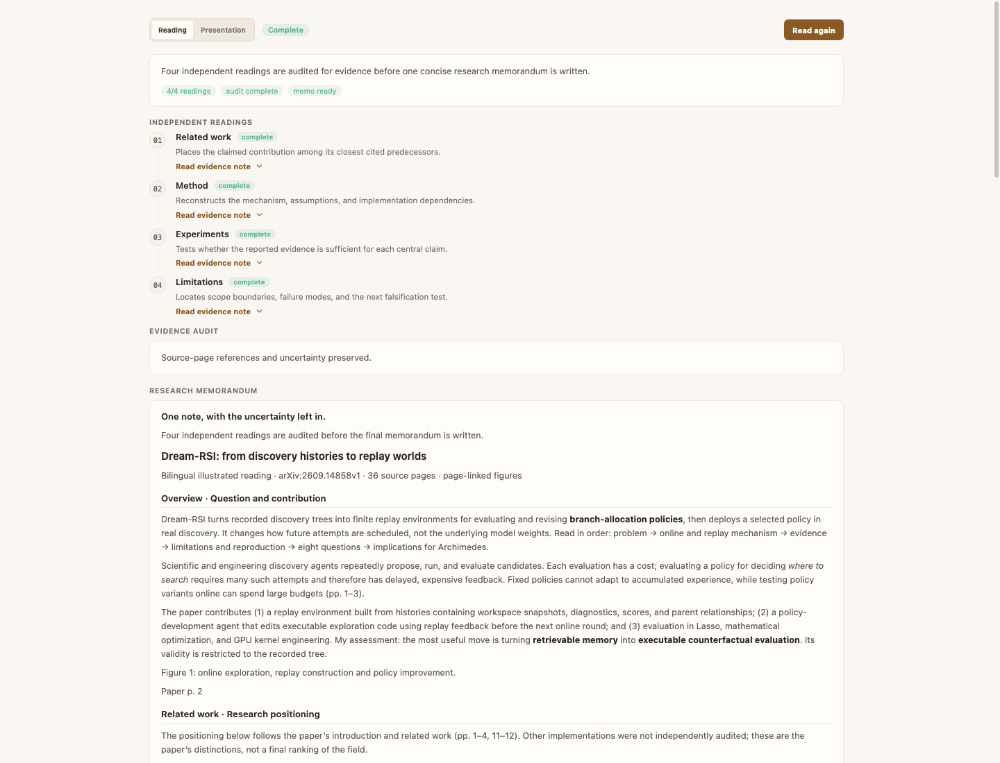
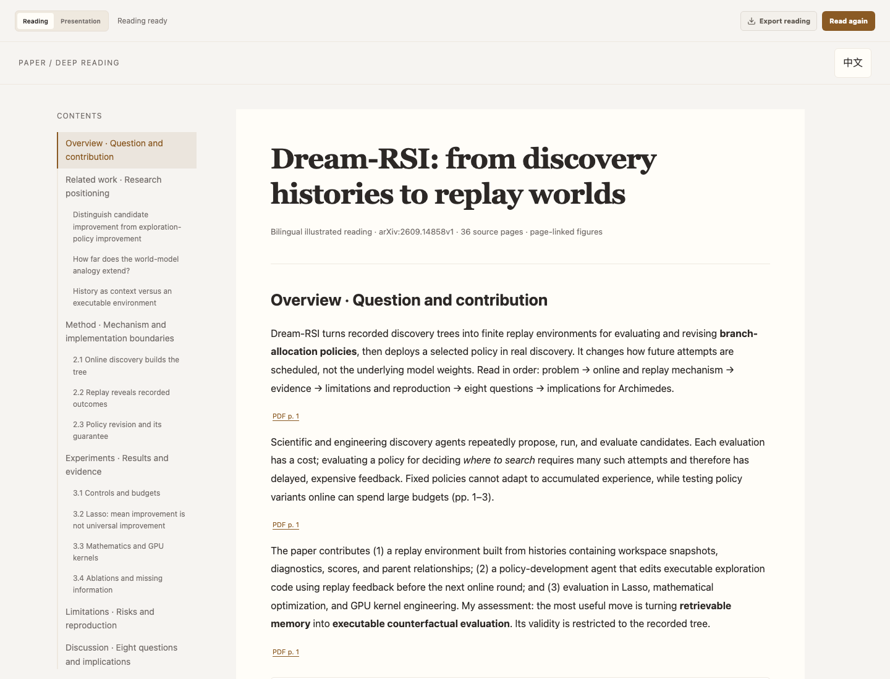
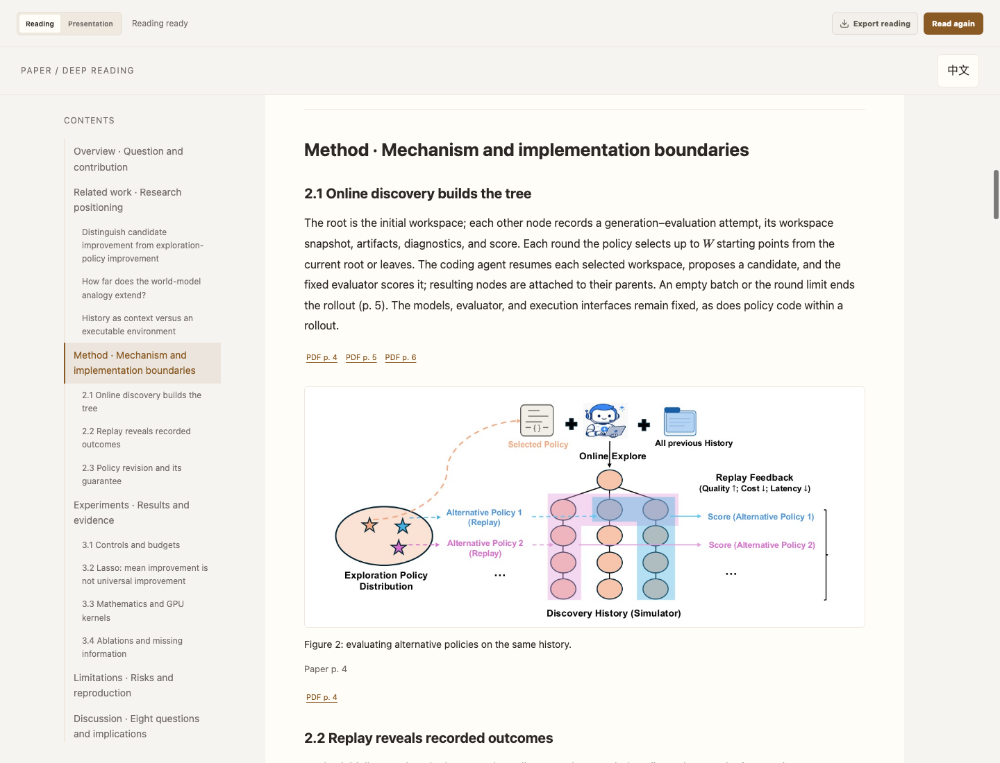
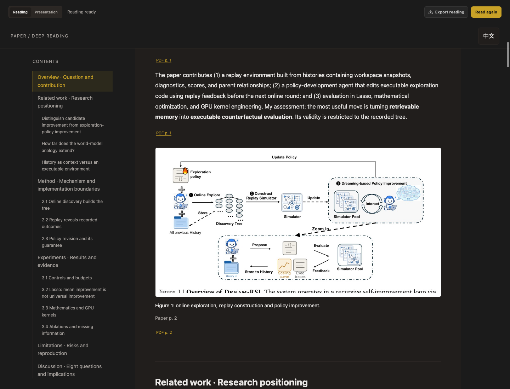
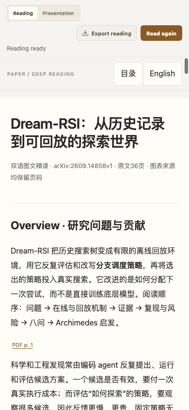
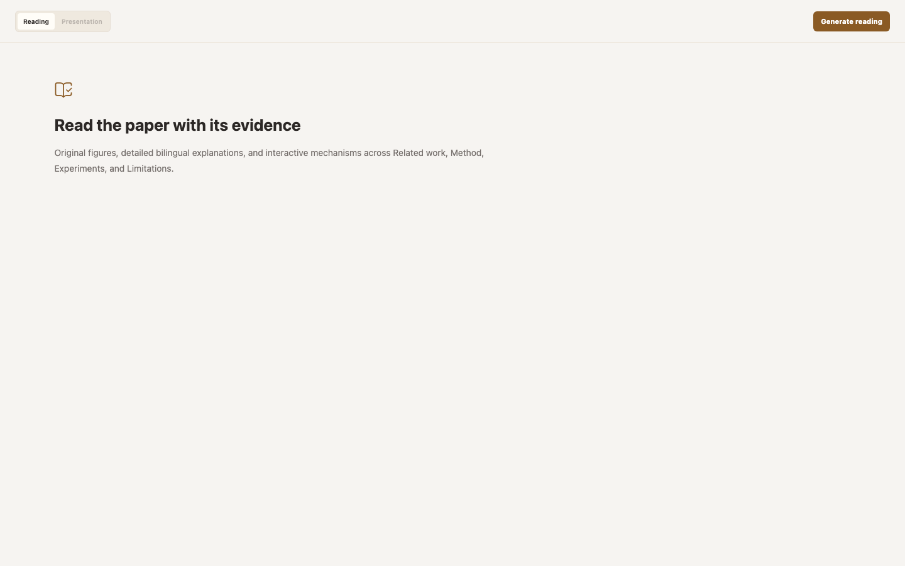
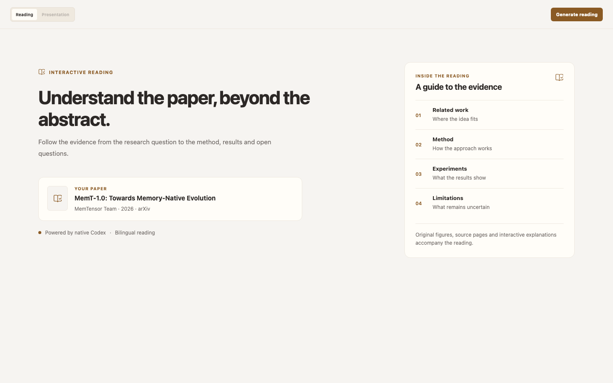
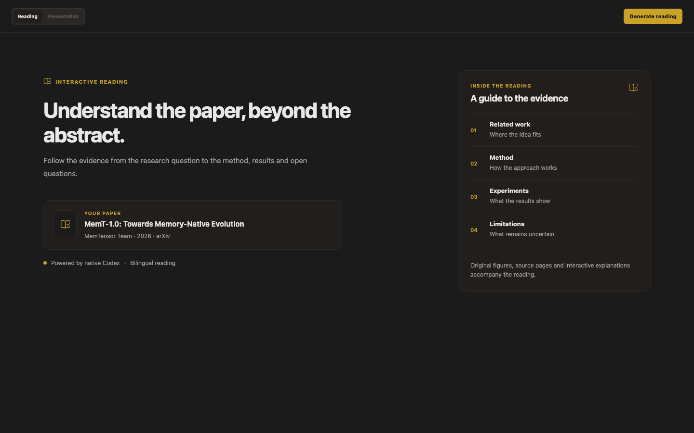

# Illustrated paper reading

Library → Interactive paper now uses the upgraded reading workflow, bundled as **`paper-deep-reading`**. The former specialist-card orchestration has been replaced; existing saved text readings and Presentation output remain accessible.

## Use

1. Restart the Electron app after updating (`npm run dev`). Renderer hot reload alone cannot load the new preload/IPC methods.
2. Open a Library paper and prepare or attach its original PDF.
3. Open Interactive paper and choose **Generate reading**. For an existing text reading, choose **Read again** to create the new version.
4. Read the bilingual document, navigate its two-level contents, enlarge original figures, step through mechanisms, or jump to cited PDF pages.
5. Choose **Export reading** to save a standalone HTML, Chinese/English Markdown, report JSON, and the referenced image assets in a new directory.

Generation invokes the installed, signed-in **native Codex** backend using its saved model, effort and permission settings under Settings → Harnesses. The bundled `paper-deep-reading` skill is attached to the native turn. Scanned PDFs need a usable OCR text layer.

## Pipeline and persistence

The desktop runtime parses the cached PDF and inventories figure/table captions. One native Codex conversation plans seven chapters, inspects page images, writes bilingual sections and audits evidence; the runtime crops originals, validates output and renders the document before replacing its saved reading. Chapters are Overview, Related work, Method, Experiments, Limitations, Discussion, and References.

Models supply typed content rather than executable HTML. Trusted rendering provides formulas, figures, comparison tables and structured mechanism diagrams. Exported documents retain page references and uncertainty notes. Model-generated claims still require scholarly review; structural validation does not establish scientific correctness.

Codex turns and page rendering run sequentially; turns resume the same native context. Native command/file approvals use a desktop dialog and honor the configured permission mode. Native execution failures are not automatically replayed; malformed content can receive one repair turn without repeating tool operations. Cancellation removes incomplete staging output and preserves the prior report. Generation artifacts live under the current data workspace's `.archimedes/paper-deep-reading/<run-id>/`; explicit exports go to the directory the user chooses. Saved reports reopen without regenerating; changed source PDFs trigger a warning.

## Verification

TypeScript, production build and theme checks pass. The full suite records 1,140 passes, four skips and six existing environment failures: three macOS temporary Git-path checks and three Windows-shell checks on macOS. A real native Codex run completed the full seven-chapter pipeline with a controlled one-page PDF and one original figure; native context resumption and image input also passed live smoke tests. Longer papers and other native model configurations may behave differently.

Browser checks cover the actual workbench, in-document navigation, figure enlargement, bilingual mechanism state, host themes, and a 390px layout without page overflow. Screenshots use public-paper fixture content, not private Library data.

## Visual evidence

The first pair uses the same 1440px viewport and light theme.

Before:

After:

## Native Codex redesign

The empty state identifies the paper and presents the four reading perspectives. Original screenshots below use the same viewport and paper fixture.

