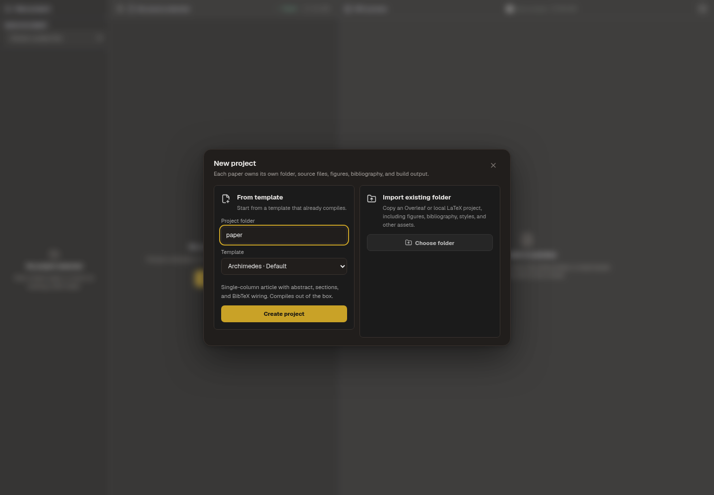
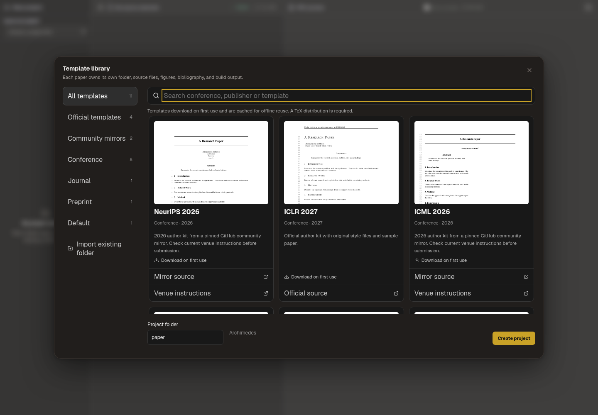

# Paper Writing template library

Open Paper Writing → Projects to browse the library. Search by name or year,
select a template, enter a project folder, then create it. The sidebar contains
only All templates (which resets search) and Import existing folder; its labels
use 13px text.
The existing folder import remains available for Overleaf exports and other kits.

The chooser contains six conference kits plus five publisher/journal starters. Official author kits and clearly labelled community mirrors are downloaded on first
use from raw.githubusercontent.com at pinned upstream commits. Their text assets
are SHA-256 verified before use and cached under Electron's userData directory
in `latex-template-cache`. Subsequent project creation can use that cache offline.
No upstream style files are modified. The original main document is renamed to
`main.tex`; an `ARCHIMEDES-SOURCE.txt` file records the source and revision.

## Sources

| Kit | Download source | Delivery |
| --- | --- | --- |
| ICLR 2027 / 2026 | https://github.com/ICLR/Master-Template | Download and cache |
| CVPR 2026 | https://github.com/cvpr-org/author-kit/tree/CVPR2026-v1(latex) | Download and cache |
| ACL / EMNLP / NAACL / EACL current style | https://github.com/acl-org/acl-style-files | Download and cache |
| NeurIPS 2026 | https://github.com/WuizaKaseiyo/paper-templates | Community mirror; download and cache |
| ICML 2026 | https://github.com/lunatila/icml-paper-skill | Community mirror; download and cache |

Exact immutable revisions, asset URLs and checksums are stored in
`shared/official-latex-templates.json`. Upstream terms and venue submission rules
continue to apply. These kits are fetched on the user's machine rather than
redistributed as bundled third-party source. Years identify specific kits, not a
promise that the kit matches a venue's next submission deadline. The NeurIPS and ICML websites remain blocked by this cloud network policy.
The 2026 kits are fetched from GitHub community mirrors, not from the conference
organizations. The cards expose both the mirror and official venue instructions.
No usable 2027 kit was found in this search, so the UI labels them as 2026.
Hashes verify the pinned mirror contents, not equivalence to the latest official
ZIP. Different mirror snapshots can contain different revisions (for example,
the newer NeurIPS ZIP mirrored by paper-migrate adds an Education track option).
Check current conference instructions before submission.

The ACL kit is shared by ACL, EMNLP, NAACL and EACL. They share one card so it
does not imply different style files; every venue name is searchable.

## Verification

- Real upstream download, checksum and creation checks passed for all six kits.
- The original ICLR 2026, ICLR 2027, CVPR 2026, NeurIPS 2026 and ICML 2026 sample papers compiled with latexmk.
- The original ACL sample requires `inconsolata.sty`, absent from this cloud TeX
  installation used for the earlier system-compiler check. The default compiler
  is now managed Tectonic; see its separate validation limits.
- Thumbnail previews are locally authored short documents rendered with the
  respective upstream styles, not screenshots of upstream sample paper text.
- Unit tests exercise cache reuse, corrupt data, unsafe asset paths, failed
  downloads, preservation of a clean workspace on download failure, and binary PDF figure
  preservation. The ICML sample includes a PDF figure that must not be decoded
  as UTF-8.
- Legacy general-layout templates remain covered by compilation regression tests;
  they no longer appear in the template chooser.
- UI screenshots use the real PaperWritingView in a local Vite fixture at
  1440 × 1000. The Electron window was not tested because this cloud session's
  desktop startup remains unavailable. See the before/after evidence below.

For missing-font setup instructions and current library screenshots, see
[Conference templates and missing TeX fonts](paper-writing-fonts.md).

Paper Writing now uses the [managed local compiler](managed-latex-engine.md),
which downloads and caches TeX dependencies automatically.

Current sidebar screenshots: [before](assets/template-sidebar-simplification/before.png),
[after](assets/template-sidebar-simplification/after.png), and
[light theme](assets/template-sidebar-simplification/after-light.png).

For ACM, JMLR, TMLR, Elsevier and IEEE sources and validation, see
[Publisher and journal starters](publisher-templates.md).
