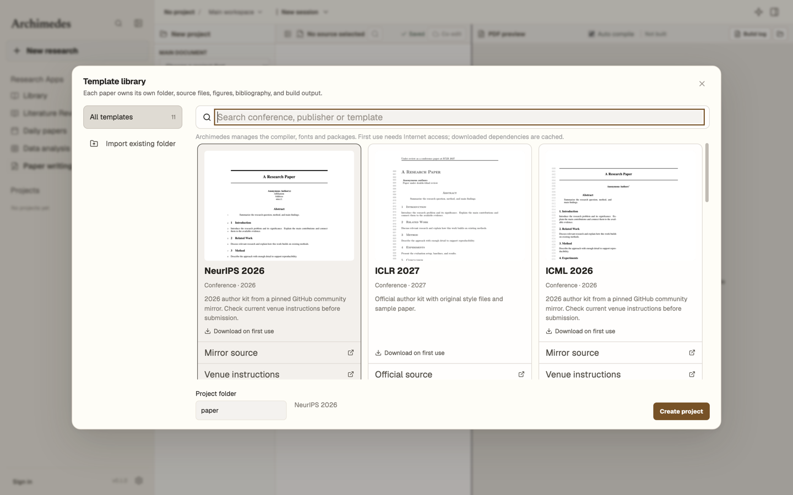
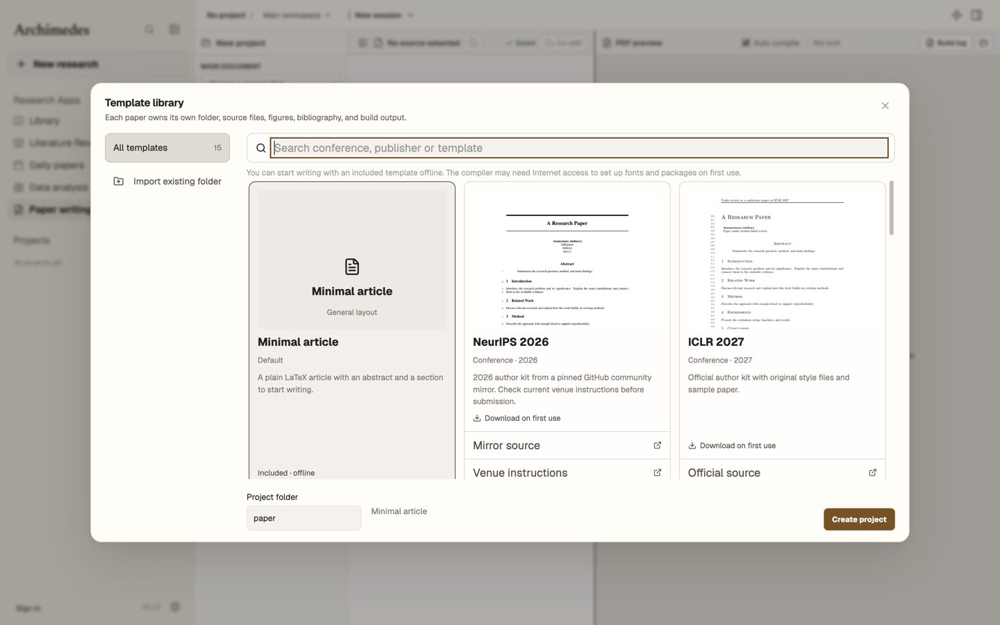
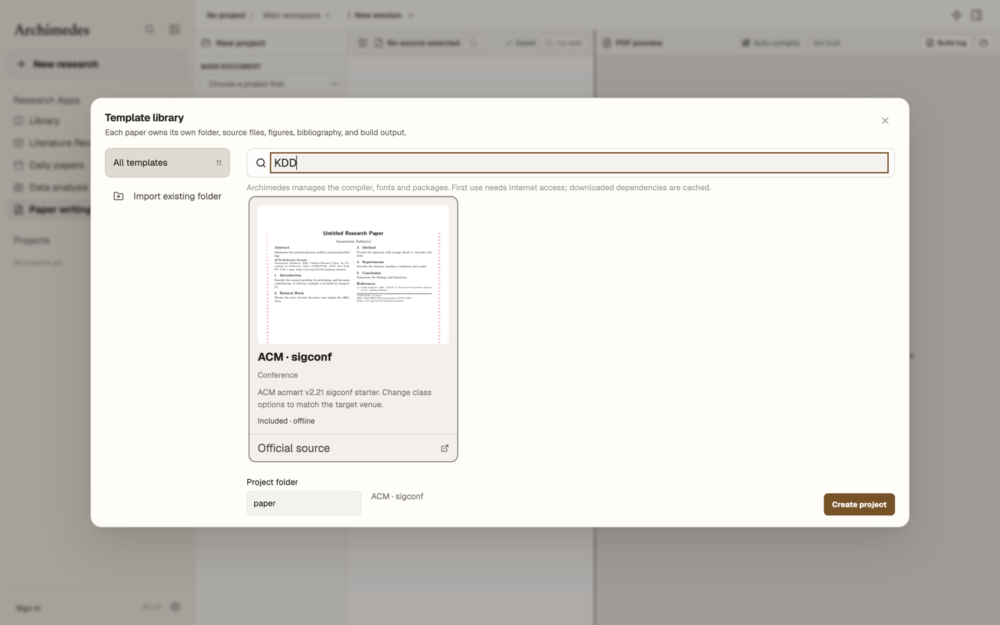
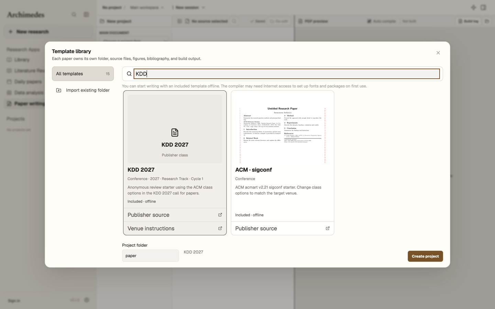
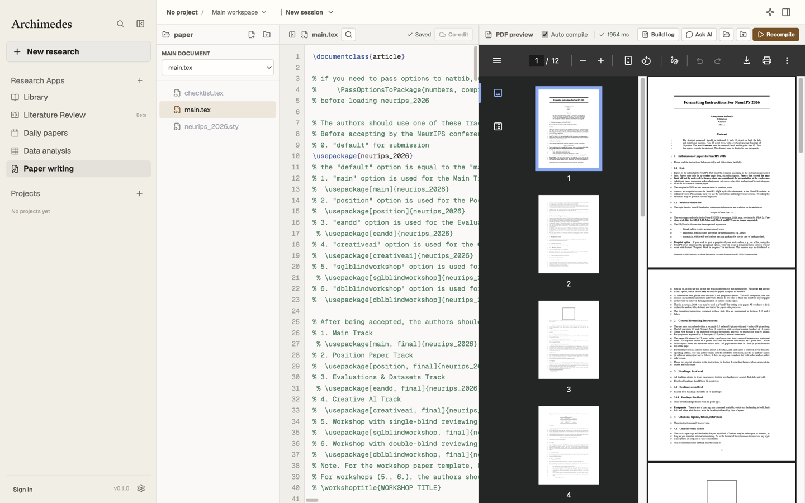
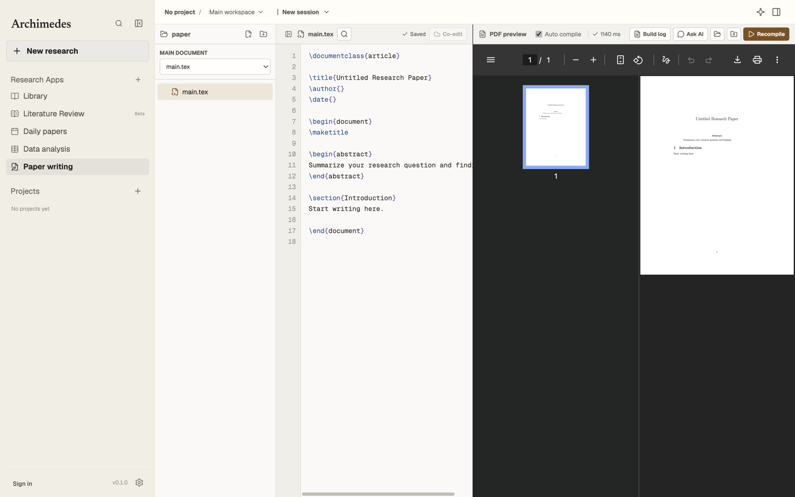
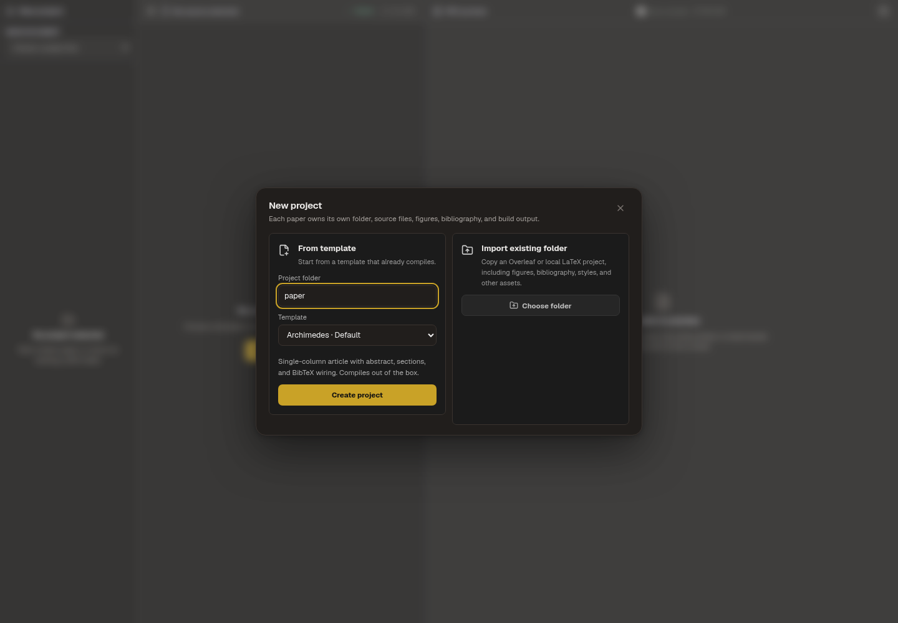
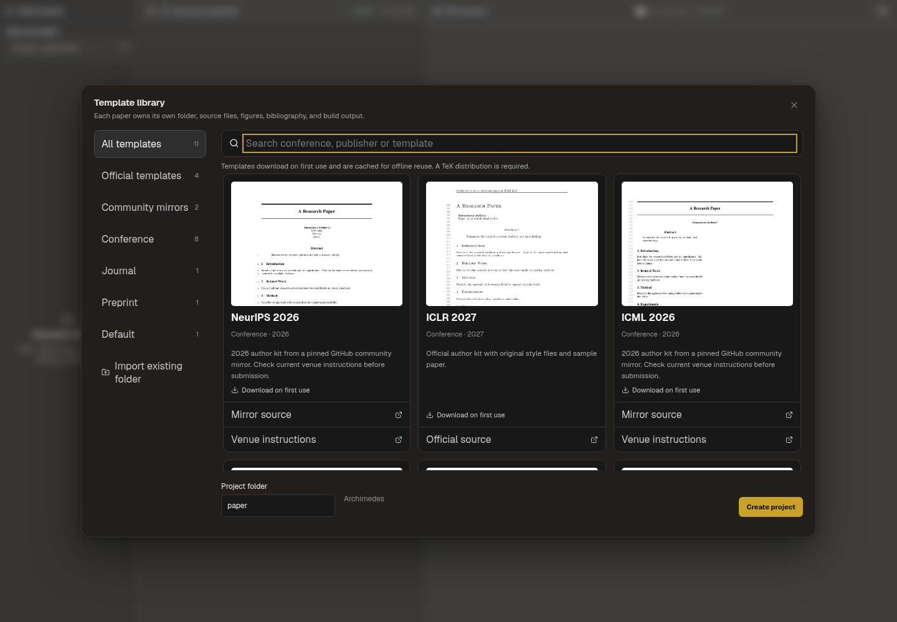

# Paper Writing template library

In Paper Writing, open **Projects**. **Minimal article** is
selected by default. It contains one `main.tex` file using LaTeX's standard
`article` class and can be created offline. On first compile, the managed engine
may need Internet access to set up its fonts and packages.

Search by venue, year or track. Select a template, name the project folder, and
click **Create project**. The downloadable conference kits and community mirrors
come from pinned upstream commits. Archimedes verifies their assets against
SHA-256 digests before use and caches them under Electron's userData directory
in `latex-template-cache`. Subsequent project creation can use that cache offline.
Archimedes preserves the upstream style files. Each downloaded project starts
with `main.tex` and records its source and revision in `ARCHIMEDES-SOURCE.txt`.

## Sources

| Kit | Download source | Delivery |
| --- | --- | --- |
| ICLR 2027 / 2026 | https://github.com/ICLR/Master-Template | Download and cache |
| CVPR 2026 | https://github.com/cvpr-org/author-kit/tree/CVPR2026-v1(latex) | Download and cache |
| ACL / EMNLP / NAACL / EACL current style | https://github.com/acl-org/acl-style-files | Download and cache |
| NeurIPS 2026 | https://github.com/WuizaKaseiyo/paper-templates | Community mirror; download and cache |
| ICML 2026 | https://github.com/lunatila/icml-paper-skill | Community mirror; download and cache |
| COLM 2026 Main conference | [2026 release](https://github.com/COLM-org/Template/releases/tag/2026) · [Call for papers](https://colm.cc/Conferences/2026/CallForPapers) | Download and cache the pinned submission kit |
| AAAI 2027 Main Technical Track | [Author Kit ZIP](https://aaai.org/authorkit27/) · [Submission instructions](https://aaai.org/conference/aaai/aaai-27/submission-instructions/) | Download in the browser and import the extracted folder |
| KDD 2027 Research Track, Cycle 1 | [ACM acmart class](https://github.com/borisveytsman/acmart/tree/v2.21) · [Call for papers](https://kdd2027.kdd.org/research-track-call-for-papers/) | Bundled Archimedes starter with the ACM `sigconf,anonymous,review` options |

For AAAI, select **AAAI 2027** and click **Download official author kit**.
Unzip the download, then use **Import existing folder** to select `AuthorKit27`.
Open `AnonymousSubmission2027.tex` as the main document. The official style file
requires pdfTeX. To build the sample, run `pdflatex AnonymousSubmission2027.tex`,
`bibtex AnonymousSubmission2027`, then `pdflatex AnonymousSubmission2027.tex`
twice in the imported `AuthorKit27` folder with a local TeX distribution.
The Paper Writing **Recompile** button uses managed Tectonic (XeTeX), which the
AAAI style file rejects with `pdfTeX is required to compile this document.`

KDD also matches the generic **ACM · sigconf** card in search. The **KDD 2027**
card names the track and cycle and links the corresponding call for papers.

Exact immutable revisions, asset URLs and checksums are stored in
`shared/official-latex-templates.json`. Upstream terms and venue submission rules
continue to apply. Use the year to identify the kit and check the instructions
for your submission deadline.
The NeurIPS 2026 and ICML 2026 kits come from GitHub community mirrors. Their
cards link to both the mirror and official venue instructions.
No usable 2027 kit was found in this search, so the UI labels them as 2026.
Hashes verify the pinned mirror contents, not equivalence to the latest official
ZIP. Different mirror snapshots can contain different revisions (for example,
the newer NeurIPS ZIP mirrored by paper-migrate adds an Education track option).
Check current conference instructions before submission.

The ACL kit is shared by ACL, EMNLP, NAACL and EACL. They share one card so it
does not imply different style files; every venue name is searchable.

## Verification

Electron 43.4.1 on macOS arm64 created and saved a minimal article, a COLM 2026
paper, and a KDD 2027 Research Track paper and displayed their PDFs. The minimal
article built with the managed engine and dependency cache populated and an
unreachable proxy. COLM's checked assets were reused with the downloader
disabled. The AAAI kit imported with `AnonymousSubmission2027.tex` selected and
the managed compiler reported the pdfTeX requirement above. The existing
manuscript fixture stayed byte-for-byte identical.

The comparisons use Electron at 1440 × 900 with the Paper theme and English UI.

| Surface | Before | After |
| --- | --- | --- |
| Default template |  |  |
| KDD search |  |  |
| Resulting manuscript |  |  |

### Earlier template library validation

- Real upstream download, checksum and creation checks passed for all six kits.
- The original ICLR 2026, ICLR 2027, CVPR 2026, NeurIPS 2026 and ICML 2026 sample papers compiled with latexmk.
- The original ACL sample requires `inconsolata.sty`, absent from this cloud TeX
  installation used for the earlier system-compiler check. The default compiler
  is now managed Tectonic; see its separate validation limits.
- Thumbnail previews are locally authored short documents rendered with the
  respective upstream styles, not screenshots of upstream sample paper text.
- Unit tests exercise cache reuse, corrupt data, unsafe asset paths, failed
  downloads, preservation of a clean workspace on download failure, and binary PDF figure
  preservation. The ICML sample includes a PDF figure that must not be decoded
  as UTF-8.
- Legacy general-layout templates remain covered by compilation regression tests;
  they no longer appear in the template chooser.
- The earlier UI screenshots use PaperWritingView in a local Vite fixture at
  1440 × 1000.

For missing-font setup instructions and current library screenshots, see
[Conference templates and missing TeX fonts](paper-writing-fonts.md).

Paper Writing now uses the [managed local compiler](managed-latex-engine.md),
which downloads and caches TeX dependencies automatically.

Current sidebar screenshots: [before](assets/template-sidebar-simplification/before.png),
[after](assets/template-sidebar-simplification/after.png), and
[light theme](assets/template-sidebar-simplification/after-light.png).

For ACM, JMLR, TMLR, Elsevier and IEEE sources and validation, see
[Publisher and journal starters](publisher-templates.md).
