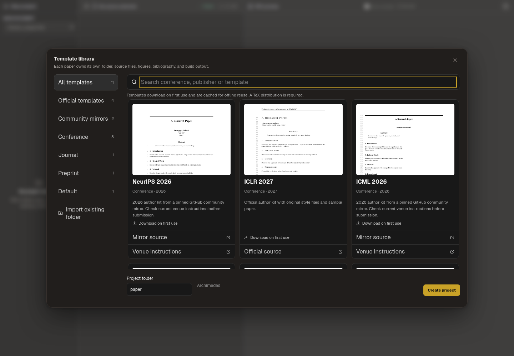
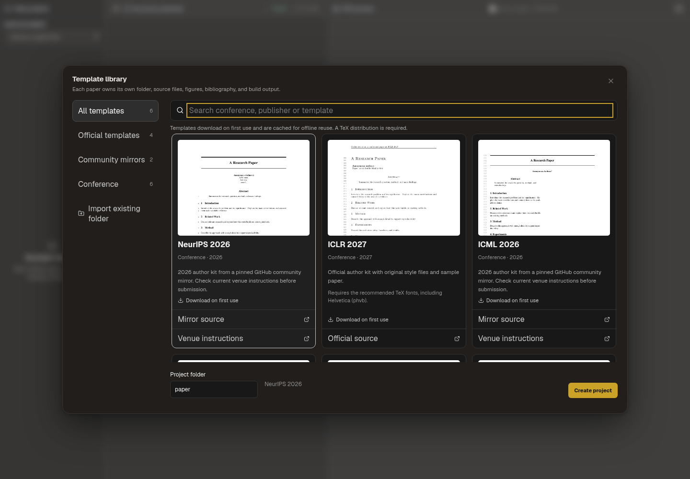

# Paper Writing fonts and template cleanup

Paper Writing now uses a managed local Tectonic engine, which downloads and
caches its own TeX resources. Users no longer need the manual font-install
commands described during the earlier diagnosis. See
[Managed local LaTeX compilation](managed-latex-engine.md) for current behavior,
network requirements and validation limits.

The earlier ICLR 2027 failure was traced to its official style selecting
Helvetica bold (`phvb`) in a minimal system TeX installation. The source was
loaded correctly; the font metric was missing. The managed engine compiled the
same source with that font available through its resource provider.

The five general-layout cards have been removed from the chooser. The six
conference kits remain; existing paper projects are preserved. Failed builds
clear the preview, and late results from a previous project are ignored.

