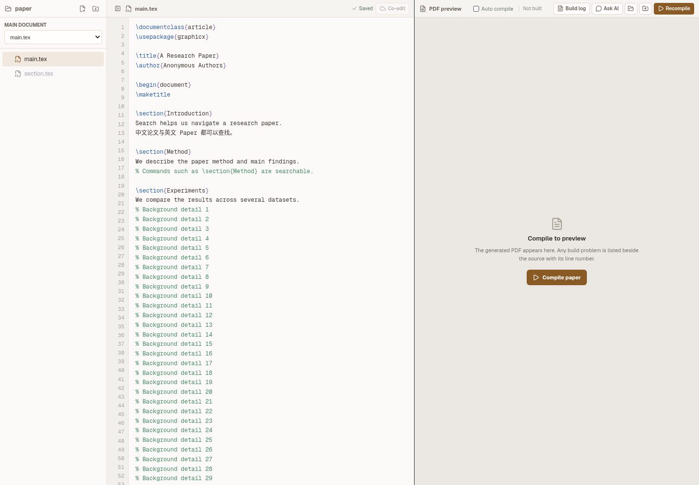
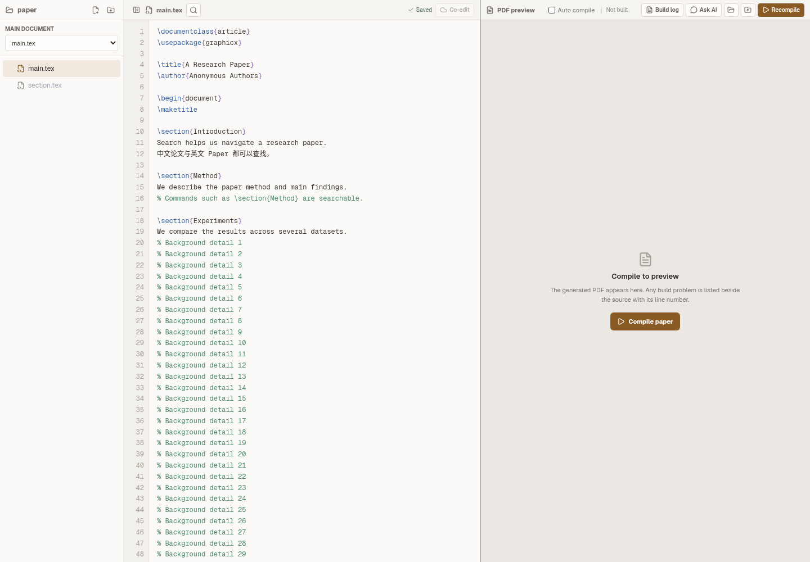
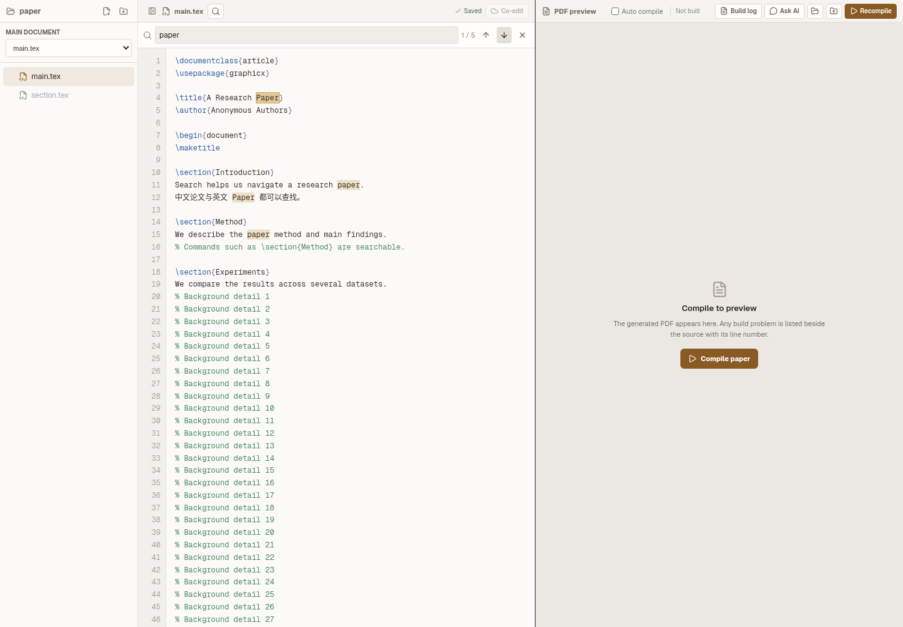

# Paper Writing source search

The source toolbar now has a magnifying-glass button for the currently open
file. Search is literal and case-insensitive, including Chinese text and LaTeX
commands. All matches are highlighted without changing syntax colors; the
current match has a stronger highlight and its position is shown beside the
query.

- Click the button or press Ctrl/Cmd+F inside the source editor to open search.
  A single-line selection becomes the initial query.
- Enter / Shift+Enter and the arrow buttons navigate forward / backward,
  wrapping at the ends and scrolling the source to the match.
- Escape or the close button returns focus to the source editor.
- Editing and switching files update the results. Empty searches and searches
  with no results disable navigation.

The optional search and build-log panels share the editor pane height. Gutter
line height and bottom padding now match the textarea so search navigation
keeps line numbers aligned even at the end of a long document.

## Visual evidence

The following pair uses the same source, Paper theme, 1440 × 1000 viewport,
pane widths, and closed search state. It renders the actual PaperWritingView
with a mocked Electron bridge; native PDF compilation is outside this audit.

Before:

After:

Search expanded:

## Validation

- `node --test electron/paper-source-search.test.cjs`: 4 passed. Covers literal
  punctuation, LaTeX commands, case-insensitive Unicode offsets, non-overlapping
  matches, multiline highlighting, and empty/newline queries.
- Headless Chromium audit of the actual React view: button state and focus,
  Ctrl/Cmd+F, selection seeding, Enter/Shift+Enter, arrow wraparound, Chinese,
  syntax-spanning highlights, no matches, horizontal/vertical scrolling with
  synchronized line numbers, Escape, autosave, file switching, and a compact
  dark-theme layout all passed with no browser errors.
- `npm run lint`, `npm run build`, and `npm run check:theme` passed. The build
  retains its existing large-chunk warning.
- `npm test`: 1221 tests, 1211 passed, 6 skipped, 4 existing failures: the
  translation-order check in `library.ts` at `back to reading`, and three
  Windows-shell profile tests in this Linux environment. No new test failures.
