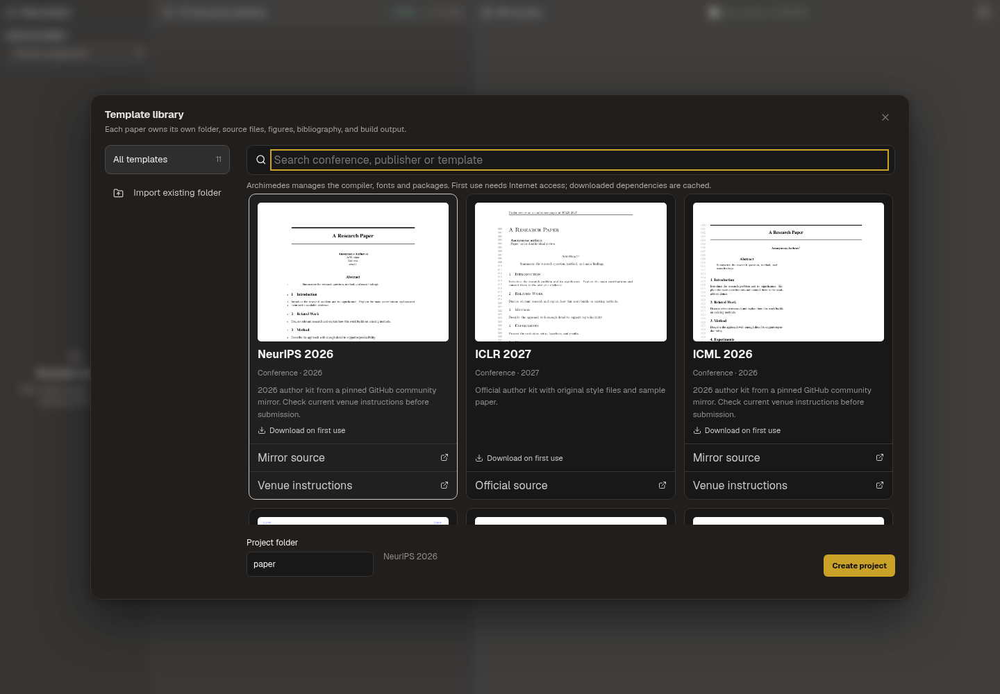
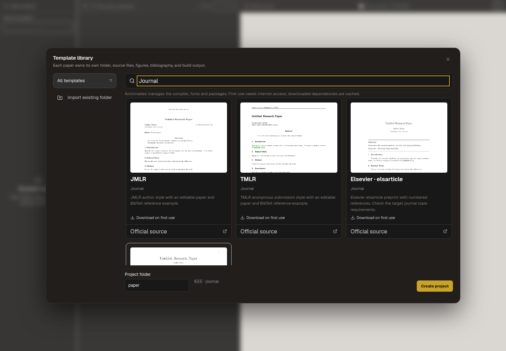

# Publisher and journal starters

The Paper Writing library now contains 11 entries: the existing six conference
kits plus ACM sigconf, JMLR, TMLR, Elsevier elsarticle and IEEE journal starters.
The sidebar still contains only All templates and Import existing folder, with
13px labels. Search aliases include KDD/SIGIR/CIKM/ACM MM for ACM, the full JMLR
and TMLR journal names, Pattern Recognition/Neural Networks/Information Sciences
for Elsevier, and TPAMI/TIP/TNNLS/TMI/TGRS for IEEE.

These are class-family starting points, not a guarantee of compliance with every
venue that uses that class. In particular, CHI can require a different acmart
layout from sigconf, TPAMI can require IEEEtran's compsoc option, and some
Elsevier journals use CAS classes instead of elsarticle. Follow the target
venue's current instructions.

## Sources and content

| Entry | Source | Included layout |
| --- | --- | --- |
| ACM | [acmart v2.21 tagged release](https://github.com/borisveytsman/acmart/tree/v2.21) | sigconf, review, anonymous |
| JMLR | [JmlrOrg/jmlr-style-file](https://github.com/JmlrOrg/jmlr-style-file) | jmlr2e author style |
| TMLR | [JmlrOrg/tmlr-style-file](https://github.com/JmlrOrg/tmlr-style-file) | anonymous submission |
| Elsevier | [STM-Document-Engineering/elsarticle](https://github.com/STM-Document-Engineering/elsarticle) | preprint with numbered citations |
| IEEE | [GitHub mirror](https://github.com/AhmedAbouelkher/ieee-paper_skill) | IEEEtran 1.8b journal; additional class options may be needed |

All upstream assets are pinned by full commit and SHA-256 in
`shared/official-latex-templates.json`. The IEEE class was byte-identical to the
copy in the independent `ebelenwaf/IEEEtran` mirror; it is still labelled as a
community mirror, not an IEEE-owned repository. Its card links the official
IEEE journal author instructions.

The new main.tex files are Archimedes-authored editable starters using the
unmodified publisher style files. JMLR, TMLR and Elsevier also retain the upstream
example as upstream-example.tex. Every project records provenance in
ARCHIMEDES-SOURCE.txt. Bibliography examples cite Leslie Lamport's real 1994
LaTeX book, rather than fictitious research papers. The IEEE starter uses a
small thebibliography example; the other four use BibTeX.

ACM distributes its class as a docstrip source. The bundled acmart.cls was
generated by running `latex acmart.ins` in the v2.21 checkout. The original
acmart.dtx, acmart.ins, README and ACM-Reference-Format.bst are shipped alongside
it, retaining the upstream copyright/license notices. No generated class edits
were made. This lets users create an ACM project offline without installing
system TeX to extract the class. The managed engine still downloads any missing
TeX/font dependencies on first compile. The other four kits download their
verified upstream assets on first use and cache them for offline project creation.

Bundled resource paths and hashes are verified before reading, and starter files
cannot traverse outside the project or overwrite an upstream asset. All files
are assembled and validated before a project directory is created.

## Validation

All five actual projects were created through createPaperProject, then compiled
with the real managed Tectonic engine and a local system-TeX validation bundle.
Each produced a PDF and its preview image. All five also passed offline project
creation with network access disabled after caching.

The ACM class detected missing Libertine, Inconsolata and newtxmath packages in
that local validation bundle and enabled its own supported font fallback.
Consequently its preview illustrates the tested layout, not a verification of
all ACM submission font requirements. The public managed bundle and the user's
Mac/network remain separate validation steps; no manual font installation is
required by the app. No system-specific .sty substitutions were made.

Unit tests cover offline bundled ACM creation, source preservation, resource
traversal, corrupt bundled checksums and conflicting starter overlays. Browser
checks verify 11 cards, all five new previews, name/venue searches, selection,
search reset, and the unchanged two-entry sidebar on narrow screens. Screenshots
use a real React-view fixture; they do not establish Electron desktop startup.

