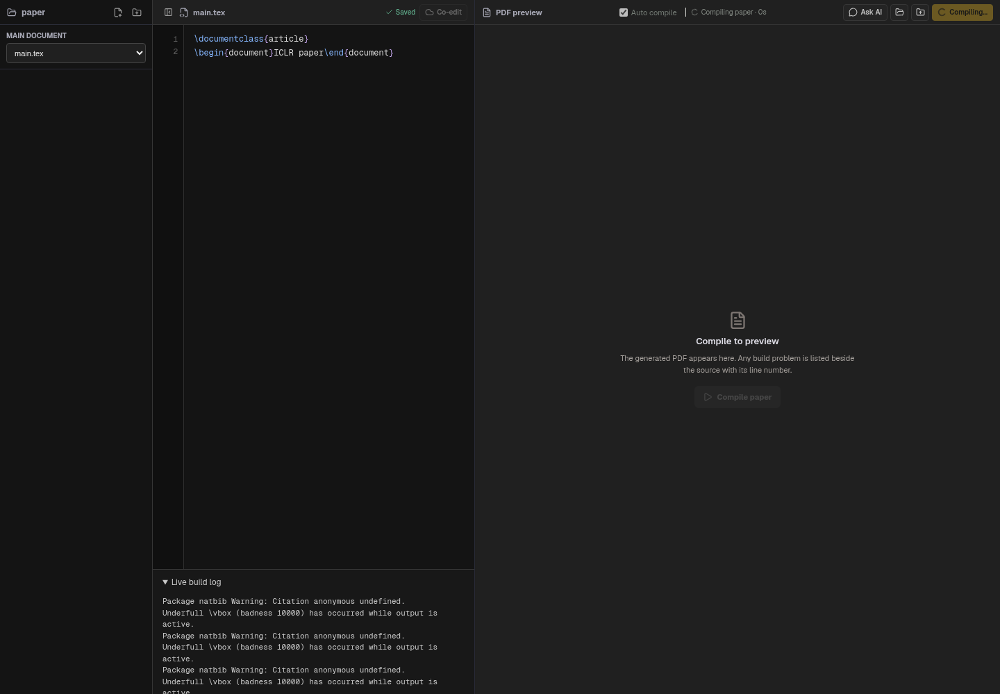
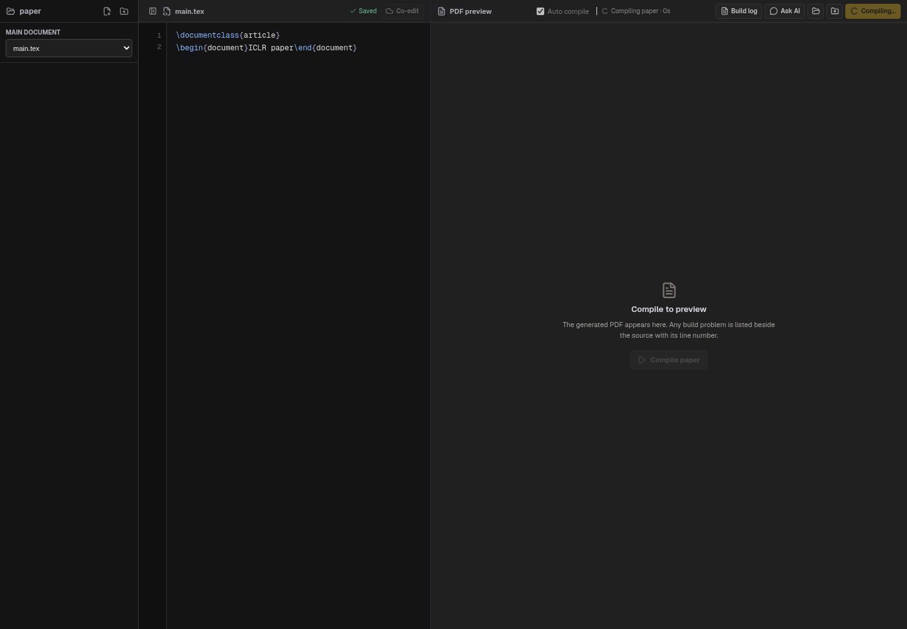
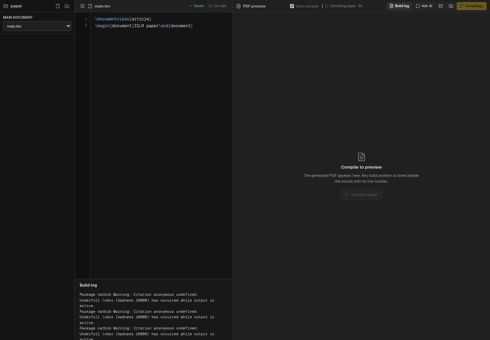

# Keep automatic compilation quiet while editing

The live compiler log previously mounted as an open details panel whenever
compilation started, then disappeared after the result. Since autosave triggers
compilation, ordinary typing repeatedly opened the panel and reduced editor space.

The toolbar now has an explicit Build log toggle. The panel is hidden by default
and its visibility is controlled only by the user's choice, independently of the
compile state. When open it shows streaming output during a build and the retained
log afterward. Switching sources clears the previous source's log. Compilation
status and failed-build diagnostics continue to work as before; the existing full
failure log can still be opened manually.

Browser verification exercised initial compilation, incoming warning output,
manual opening/closing, and three successive edits triggering autosave/compilation.
With logs closed the editor did not shrink and retained keyboard focus. Explicitly
opened logs remained open across compilation completion and subsequent edits.
The screenshots use the real React view at 1440 × 1000 with a controllable IPC
fixture, rather than a live Electron window.

