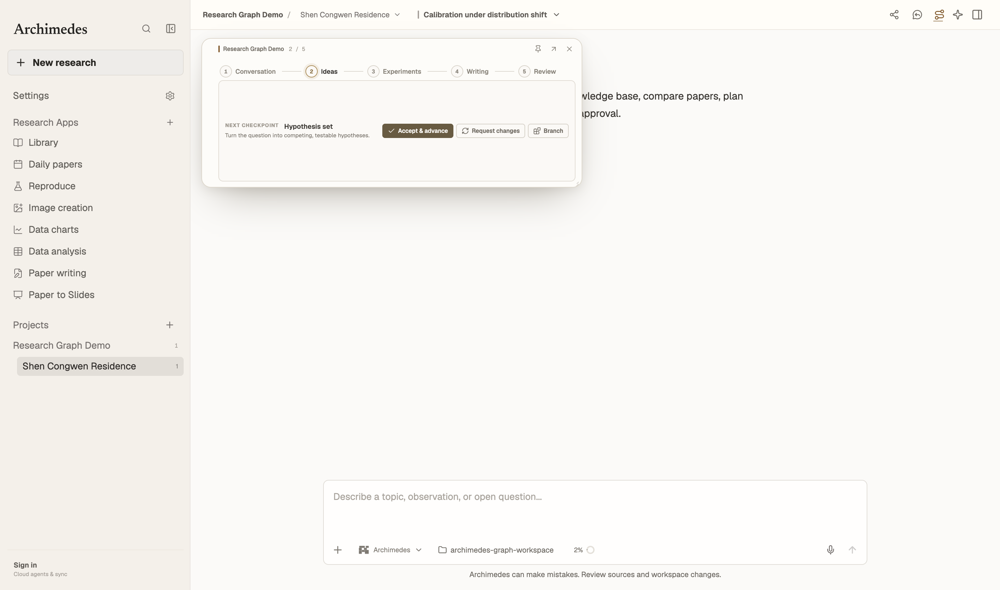
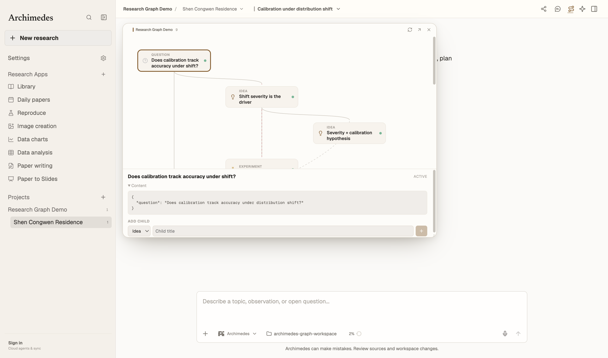
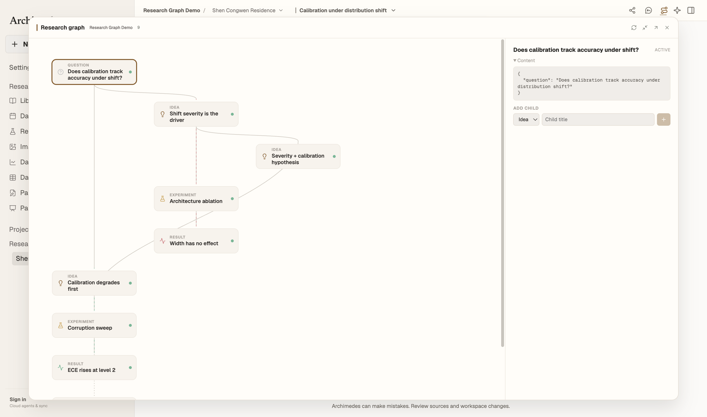

# Research graph foundation

This change adds the storage and service layer for a versioned research object
graph. It deliberately does not add the graph canvas, Git worktrees, experiment
runs, or collaboration sync yet.

## Object model

A research project owns a graph of five node kinds:

| Kind | Meaning |
| --- | --- |
| `question` | The question the project is trying to answer. |
| `idea` | A testable hypothesis. An "idea spark" is an `idea` with `status = draft`; it is not a separate node kind. |
| `experiment` | A plan that tests an idea or question. Runs are attempts inside the experiment, not graph nodes. |
| `result` | What was measured plus what it means. Evidence and interpretation live in two content blocks on one node. |
| `writing` | A paper section or claim-bearing draft. |

A node is immutable at the revision level. Editing a node creates a new
`research_node_revisions` row and moves `research_nodes.current_revision_id`.
An edge pins the revisions it connected, so later revisions do not silently
change history.

## Edge vocabulary

| Edge | From → to |
| --- | --- |
| `generates` | question → idea |
| `tests` | question or idea → experiment |
| `produces` | experiment → result |
| `supports`, `contradicts`, `inconclusive` | result → idea |
| `informs` | result → idea (a new hypothesis inspired by a result) |
| `decides` | result → idea or experiment |
| `refines` | question → question, idea → idea |
| `merges` | idea → idea, experiment → experiment, result → result |
| `extends`, `replicates` | experiment → experiment |
| `cites` | writing → result |

`supports`, `contradicts`, `inconclusive`, `informs`, and `decides` are feedback
edges and do not participate in structural cycle detection. Lineage edges do.

## Schema

New tables in `electron/store.cjs`:

- `research_nodes`
- `research_node_revisions`
- `research_edges`

Existing tables gain optional links so conversations and artifacts can be
attached to a node revision without changing their current ownership:

- `research_threads.node_id`
- `research_threads.node_revision_id`
- `research_artifacts.node_id`
- `research_artifacts.revision_id`

A SQLite trigger rejects updates to revision content, content hashes, node ids,
and parent revision ids.

## UI slice

Research mode now renders `ResearchGraphPanel` instead of the linear
`ResearchPathPanel`; Standard and Create keep the existing stepper.

- Nodes are laid out by `src/research-graph/graphLayout.ts`: time downward,
  branches in lanes, feedback edges dashed.
- Clicking a node opens the inspector and shows its current revision content.
- A selected node exposes its allowed child kinds. Creating a child writes the
  node and its typed edge; creating writing from a result creates the writing
  node and then links `cites`.
- Empty projects start with a question form.
- The panel header expands the graph into a full-window view with the inspector
  beside it; Escape or the minimize button returns to the dock.

| Before | After (dock) | After (expanded) |
| --- | --- | --- |
|  |  |  |

## Service API

`electron/research-graph/service.cjs` exposes:

```text
createNode({ projectId, kind, status, title, summary, content, parents, author })
reviseNode({ nodeId, content, title, summary, sourceTurnId, sourceEventId, gitCommit, author })
linkNodes({ fromNodeId, toNodeId, kind, fromRevisionId, toRevisionId, metadata, author })
listGraph({ projectId, includeArchived })
getNodeHistory(nodeId)
archiveNode({ nodeId, reason, author })
restoreNode({ nodeId, author })
validateGraph({ projectId })
```

The matching IPC channels are `research-graph:create-node`,
`research-graph:revise-node`, `research-graph:link`, `research-graph:list`,
`research-graph:history`, `research-graph:archive`, `research-graph:restore`,
and `research-graph:validate`.

## Invariants enforced now

- Only the five node kinds and thirteen edge kinds are accepted.
- An experiment or result must have a parent.
- Edges must connect allowed node kinds in the same project.
- Structural edges cannot create a cycle.
- A merge node needs at least two parent edges.
- Revisions are append-only.
- Archived nodes remain readable and restorable; nothing is hard-deleted.
- `validateGraph` reports malformed graphs created by lower-level callers.

## Intentionally out of scope

- Graph rendering and the Node Inspector.
- Node Chat and context packs.
- Git worktrees and experiment branches.
- Run submission and detached supervisors.
- Merge proposals, tags, and research commits.
- Collaboration sync and RLS.

## Validation

```sh
node --test electron/research-graph.test.cjs
node --test electron/research-graph-layout.test.cjs
node --test electron/store-schema-order.test.cjs
npm run lint
npm run build
```

The full suite has pre-existing macOS failures in Windows-shell, LaTeX,
Benchmark Radar, Git-state, and workspace-session tests. The new graph tests do
not touch those paths.
