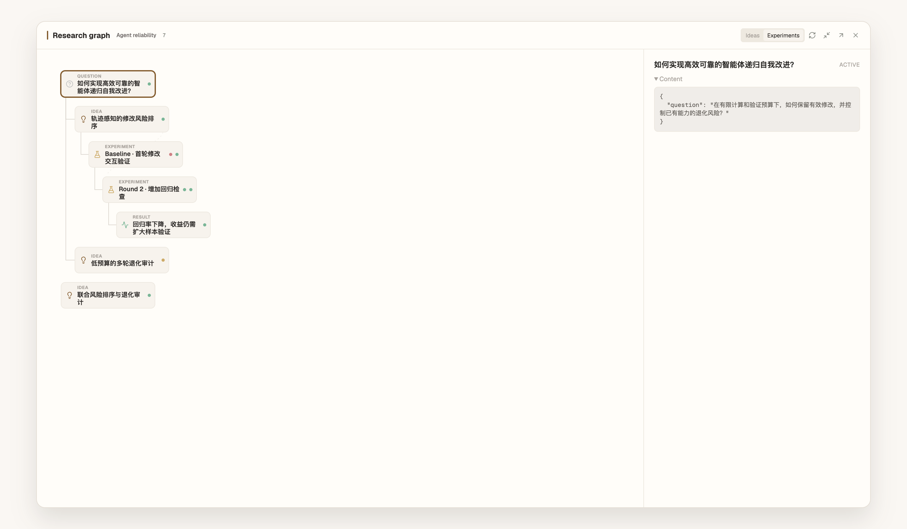
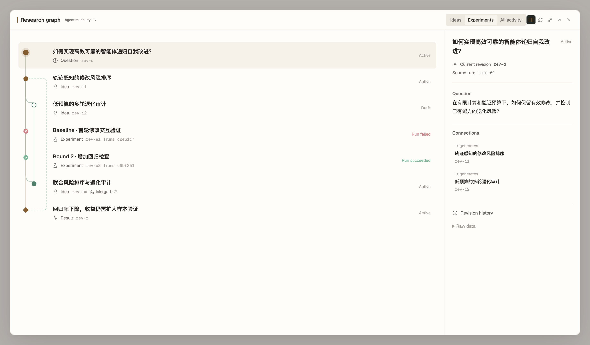

# Research graph foundation

This change adds the storage and service layer for a versioned research object
graph, automatic extraction, a lineage view, and recorded local experiment runs.
Git worktrees, node-scoped context packs, remote experiment backends, and graph
collaboration sync are not implemented yet. See [the current implementation review](./research-graph-review.md) for the gap analysis and development sequence.

## Object model

Each Research session owns an independent graph. A project can contain many
sessions, but nodes and edges never cross session boundaries.

The graph has five node kinds:

| Kind | Meaning |
| --- | --- |
| `question` | The question this session is trying to answer. |
| `idea` | A testable hypothesis. An "idea spark" is an `idea` with `status = draft`; it is not a separate node kind. |
| `experiment` | A plan that tests one or more ideas. Runs are attempts inside the experiment, not graph nodes; each run records its own command, log, exit code, and commit. |
| `result` | What was measured plus what it means. Evidence and interpretation live in two content blocks on one node. |
| `writing` | A paper section or claim-bearing draft. |

A node is immutable at the revision level. Editing a node creates a new
`research_node_revisions` row and moves `research_nodes.current_revision_id`.
An edge pins the revisions it connected, so later revisions do not silently
change history.

## Edge vocabulary

| Edge | From → to |
| --- | --- |
| `generates` | question → idea |
| `tests` | idea → experiment |
| `produces` | experiment → result |
| `supports`, `contradicts`, `inconclusive` | result → idea |
| `informs` | result → idea (a new hypothesis inspired by a result) |
| `decides` | result → idea or experiment |
| `refines` | question → question, idea → idea |
| `merges` | idea → idea, experiment → experiment, result → result |
| `extends`, `replicates` | experiment → experiment |
| `cites` | writing → result |

`supports`, `contradicts`, `inconclusive`, `informs`, and `decides` are feedback
edges and do not participate in structural cycle detection. Lineage edges do.

## Schema

New tables in `electron/store.cjs`:

- `research_nodes` (`project_id`, `thread_id`, `source_run_id`)
- `research_node_revisions`
- `research_edges` (`project_id`, `thread_id`)
- `experiment_runs` (`project_id`, `thread_id`, `node_id`, `status`)

`thread_id` is the graph scope. `listGraph`, `applyPatch`, and `validateGraph`
accept it; `createNode` and `linkNodes` reject parents or edges that cross
sessions. Existing project-scoped graph data is migrated on open: nodes inherit
the session of their earliest source turn, explicit thread links are honored,
and remaining manual nodes fall back to the oldest Research session in the
project. Edges whose endpoints land in different sessions are left unscoped and
are not shown in a session graph.

Existing tables gain optional links so conversations and artifacts can be
attached to a node revision without changing their current ownership:

- `research_threads.node_id`
- `research_threads.node_revision_id`
- `research_artifacts.node_id`
- `research_artifacts.revision_id`

A SQLite trigger rejects updates to revision content, content hashes, node ids,
and parent revision ids.

## Atomic graph updates

`applyPatch` uses a synchronous SQLite savepoint around the entire extraction
update. Individual node/revision/edge writes use nested savepoints so releasing
one write cannot commit part of the patch. Validation errors, link failures, and
retirement failures roll back content enrichment, new objects, statuses, project
timestamps, and their audit records. Failed patches leave no archived debris.
Existing supersede rules are unchanged; a valid retry commits normally.

Fault-injection coverage lives in `electron/research-graph-atomic.test.cjs`.
The [before/after evidence](./assets/research-graph/atomicity-tests.txt) reproduces
three failures against the preceding commit and passes all four regression cases
with the fix.

## UI slice

Research mode now renders `ResearchGraphPanel` instead of the linear
`ResearchPathPanel`; Standard and Create keep the existing stepper.

- Nodes use a compact Git-style rail with a shared text column. Structural parents
  precede children, merges retain both incoming connections, and selected ancestry
  is highlighted. The original stored citation direction remains unchanged while
  the visual flow leads from evidence to writing.
- Clicking a node emphasizes its structural ancestor paths. Unrelated nodes and
  edges become gray and dashed; the highlighted paths render above unrelated
  markers so crossings do not obscure them. Merges show all actual parents.
  Click the selected node again to return to the full-color overview. Feedback
  edges remain distinct from structural ancestry; graph data is unchanged.
- Marker shapes distinguish questions (circle), ideas (diamond), experiments
  (rounded square), results (hexagon), and writing (page). Experiment success and
  failure continue to use check and cross symbols, as well as status text.
- The panel is read-only: the model creates research objects from the main chat.
  The inspector shows readable content, provenance, related nodes, immutable
  revision history, experiment plans, runs and logs. Raw JSON is collapsed.
- Graph data remains scoped to one session. By default the panel follows the
  active session; a pin intentionally keeps a selected session visible across
  navigation and is saved locally. The header shows that session's title and
  pinned state. Click the pin again to follow the active session. An unsent new
  chat has no saved graph yet. Late responses from a previous session cannot
  replace the current graph.
- Ideas shows questions and hypotheses; Experiments adds experiments and results;
  All activity also includes existing writing nodes and citation edges. Stored
  merge and feedback relationships are visible. The extractor does not yet create
  writing or merge relationships automatically.
- History reveals retracted and archived records without deleting them. Selecting
  a relationship opens the related node; the relationship lists its pinned revision.
- Empty sessions explain that a Research conversation builds the graph; there is
  no manual question or node-authoring form.
- The header opens the graph in the shared Dialog, with optional node details.
  Escape or minimize returns to the dock. Standard mode keeps its existing UI.

Same fixture, window, Paper theme, experiment scope and selected question:

| Before: indented cards | After: shared text column and branch rail |
| --- | --- |
|  |  |

Additional checks: [full activity and evidence](./assets/research-graph/lineage-evidence.png),
[dark theme](./assets/research-graph/lineage-dark.png), and
[narrow window](./assets/research-graph/lineage-narrow.png). These use illustrative
renderer fixtures, not real experiment results or a claim of completed replay.

The marker update is shown with the same fixture and dark theme
[before](./assets/research-graph/markers-before.png) and
[after](./assets/research-graph/markers-after.png); also see the
[Paper theme](./assets/research-graph/markers-paper.png).

The pinned-session indicator and control are shown with the same fixture and
viewport [before](./assets/research-graph/session-pin-before.png) and
[after](./assets/research-graph/session-pin-after.png); a
[narrow-window check](./assets/research-graph/session-pin-narrow.png) is also included.

Path emphasis is shown with the same selected experiment and fixture
[before](./assets/research-graph/path-focus-before.png) and
[after](./assets/research-graph/path-focus-after.png); also see the
[dark-theme check](./assets/research-graph/path-focus-dark.png).

## Automatic graph building

Every successful Research-mode turn now schedules a background graph build for
the active session. The turn itself is not blocked; the answer and composer are
released first. Extraction is stage-aware:

- **Idea discussion:** only question and idea nodes, with `generates` and
  `refines` edges. Proposed validation and experiment ideas stay inside the
  idea content; no experiment nodes are created.
- **Experiment setup:** experiment nodes are allowed, but every experiment must
  have at least one `tests` edge from an idea. Experiments never attach directly
  to a question, and one idea may have multiple experiments. A result node is
  allowed only when the answer reports a measured outcome (a number, metric,
  table, or observed result); proposals and promises to run do not create
  results. The stage uses `generates`, `refines`, `tests`, `extends`,
  `replicates`, and `produces`; the view can display existing feedback edges,
  although the current extractor does not generate them.
- **Result provenance:** a result extracted from the conversation records
  `evidence.source = "conversation"`. A result created by
  `createResultFromRun` records `evidence.source = "run"` plus the run id,
  command, exit code, commit, and log tail. Both are visible as result nodes;
  the inspector shows which evidence backed the result.

- **API harness:** the extractor reuses the active Agent model with a JSON-only
  prompt and JSON response mode. It never exposes tools and is capped at a short
  output. A parse or validation failure retries once with a smaller-patch
  prompt; a terminal failure is recorded as `graph_failed` and never fails the
  Research turn.
- **Native harnesses:** Codex, Claude Code, and OpenCode run one transient
  extraction turn with no conversation history. The call uses read-only (Codex)
  or plan (Claude Code) permissions and a no-op approval handler; the main chat
  thread and its native binding are untouched.
- The extractor receives the user prompt, the assistant answer, and a bounded
  summary of the existing project graph. It returns a patch of at most six new
  nodes and eight new edges.
- `applyPatch` validates node kinds, edge pairs, duplicate edges, parent rules,
  cycles, and ownership before writing. Nodes that match an existing node by
  kind and normalized title are reused instead of duplicated.
- New nodes and edges are applied automatically. Each new revision records the
  source `turn_id`; the thread receives a `graph_applied` event (or
  `graph_checked` when nothing was added).
- A new idea round supersedes the previous one. When a patch adds at least two
  new ideas directly under the same question, the previous direct idea children
  of that question become `retracted`. The extractor may also name specific
  `supersede` entries with a reason. Retracted ideas stay in the database and
  are shown only when History is enabled; they are never hard-deleted.
- The graph panel listens for `graph_update` events, refreshes in place, and
  shows a compact "Research graph updated" bar with an Undo action. Undo
  archives only the nodes created by that patch and restores any superseded
  nodes to their previous status, so earlier graph history remains intact.
- If extraction fails, times out, or returns no research object, the graph is
  unchanged and the failure is not treated as a turn failure.
- Result nodes are created only when the answer reports a measured outcome, or
  by `createResultFromRun` from a completed run. Conversation-extracted results
  are marked with `evidence.source = "conversation"`; run-backed results carry
  the run id, command, exit code, commit, and log tail.

## Experiment runs

The experiment node is the plan. Each `experiment_runs` row is one attempt:

| Field | Meaning |
| --- | --- |
| `status` | `starting`, `running`, `succeeded`, `failed`, or `cancelled`; terminal states never change. |
| `command` | The shell command that was run. |
| `cwd` | The folder the command ran in. |
| `commit_sha` | `git rev-parse HEAD` at launch, when the folder is a Git worktree. |
| `log_path` | `.archimedes/experiment-runs/<runId>/run.log`. |
| `exit_code` | The process exit code, when the run ended. |
| `metrics` | Reserved for structured metrics; empty in the local-first v1. |

The local runner starts the command in a child process, tees stdout and stderr
into the run log, and writes the final exit line. The renderer receives
`experiment-run:update` events on status changes and can read the log tail
without loading the whole file.

Runs belong to the workspace that was active when they started. Switching
workspaces while a run is in progress is not supported in v1: the process keeps
running, but its status updates may not reach the newly opened workspace.
Interrupted runs whose process is gone are marked `failed` when the workspace
reopens.

Two rules keep run evidence comparable:

- **The command is fixed after a successful run.** A failed-only experiment is
  still provisional and may be repaired with a new command. Once a run answers
  the experiment, changing the command would invalidate the comparison; create
  a child experiment with an `extends` edge instead.
- **The plan is frozen after a successful run.** Content revisions are rejected
  while a run is active and after a successful run. Title and summary edits do
  not change the plan.

`createResultFromRun` is the run-backed result path. It requires a `succeeded`
run, records `source_run_id` on the result node, and copies the run id, command,
exit code, commit, log path, log tail, and metrics into `content.evidence`. The
result also gets a `produces` edge from its experiment. A run can produce at
most one run-backed result; the unique index on
`research_nodes(source_run_id)` enforces this.

The Experiments view shows experiment lineage (`extends`/`replicates`), the
latest run status on each node, and a read-only inspector for the plan, runs,
and log. When a conversation moves to a new round, the model creates a child
experiment with both an `extends` edge to the previous experiment and the
`tests` edge(s) of its parent idea, so the new round stays attached to the idea
while descending from the winner.

## Agent-driven experiment loop

The graph panel is read-only; the model drives the loop from the main
conversation. Both transports below use the same `experiment_runs` store and
result gate.

### API harness

Five built-in tools are available in the Experiment setup stage:

| Tool | Effect |
| --- | --- |
| `create_experiment` | Create an experiment node under an idea with a structured plan. |
| `run_experiment` | Request command approval, then start a recorded local run. |
| `wait_experiment` | Wait up to 30 seconds for a run to finish; return status, exit code, and a log tail. |
| `read_experiment_log` | Read the log tail. Status alone is not evidence. |
| `create_experiment_result` | Create a run-backed result from a succeeded run. |

`create_experiment` and `run_experiment` are hidden outside Experiment setup;
log and result tools remain available for analyzing a recorded run. Every run
still uses the same fixed-command and frozen-plan rules.

### Native harnesses

Codex, Claude Code, and OpenCode receive a small fenced directive instruction
during Experiment setup. The app strips the block from the visible answer and
executes it:

````text
```experiment
{"action":"create","idea":"...","title":"...","hypothesis":"...","baseline":"...","method":"...","metrics":["..."],"stopCriteria":"..."}
```

```experiment
{"action":"run","experiment":"...","command":"..."}
```

```experiment
{"action":"log","runId":"..."}
```

```experiment
{"action":"result","runId":"...","verdict":"supports|contradicts|inconclusive","reasoning":"..."}
```
````

Native `run` directives go through the same approval card as native commands.
The app appends a short note with the created node or run id to the answer, and
the next native turn receives a `Recent experiment runs` summary so the model
can read the log and record a result.

This is a directive bridge rather than a separate MCP process. The native
harness already owns the turn and the one-time approval surface, so the app only
needs a bounded JSON channel; the store, runner, and result gate are identical
to the API path.

## Service API

`electron/research-graph/service.cjs` exposes:

```text
createNode({ projectId, threadId, kind, status, title, summary, content, parents, sourceTurnId, sourceEventId, sourceRunId, author })
reviseNode({ nodeId, content, title, summary, sourceTurnId, sourceEventId, gitCommit, author })
createResultFromRun({ runId, verdict, reasoning, title, author })
linkNodes({ fromNodeId, toNodeId, kind, fromRevisionId, toRevisionId, metadata, author })
setNodeStatus({ nodeId, status, reason, author })
applyPatch({ projectId, threadId, turnId, patch, author, allowResults })
listGraph({ projectId, threadId, includeArchived })
getNodeHistory(nodeId)
archiveNode({ nodeId, reason, author })
restoreNode({ nodeId, author })
validateGraph({ projectId, threadId })
```

The matching IPC channels are `research-graph:create-node`,
`research-graph:revise-node`, `research-graph:link`, `research-graph:list`,
`research-graph:history`, `research-graph:archive`, `research-graph:restore`,
and `research-graph:validate`.

Experiment runs are exposed separately:

```text
listExperimentRuns({ projectId, threadId, nodeId })
startExperimentRun({ projectId, threadId, nodeId, command, cwd, workspace })
cancelExperimentRun(runId)
readExperimentRunLog({ runId, maxBytes })
createResultFromRun({ runId, verdict, reasoning })
```

The IPC channels are `experiment-run:list`, `experiment-run:start`,
`experiment-run:cancel`, `experiment-run:log`, and `experiment-run:result`.
Status changes are pushed to the renderer as `experiment-run:update`.

## Invariants enforced now

- Only the five node kinds and thirteen edge kinds are accepted.
- An experiment must test at least one idea. Experiments never attach directly to a question; one idea may have multiple experiments.
- A result must be produced by an experiment.
- Edges must connect allowed node kinds in the same project and session.
- Structural edges cannot create a cycle.
- A merge node needs at least two parent edges.
- Revisions are append-only.
- Archived nodes remain readable and restorable; nothing is hard-deleted.
- `validateGraph` reports malformed graphs created by lower-level callers.

## Intentionally out of scope

- Node Chat and context packs.
- Git worktrees and per-experiment branches.
- Remote run backends, detached supervisors that survive app exit, and
  structured metric ingestion.
- Merge proposals, tags, and research commits.
- Collaboration sync and RLS.

## Validation

```sh
node --test electron/research-graph.test.cjs
node --test electron/research-graph-layout.test.cjs
node --test electron/research-graph-auto-build.test.cjs
node --test electron/experiment-runs.test.cjs
node --test electron/experiment-directives.test.cjs
node --test electron/ui-audit-research-graph-auto.test.cjs
node --test electron/store-schema-order.test.cjs
npm run lint
npm run build
```

The full suite has pre-existing macOS failures in Windows-shell, LaTeX,
Benchmark Radar, Git-state, and workspace-session tests. The new graph tests do
not touch those paths.
