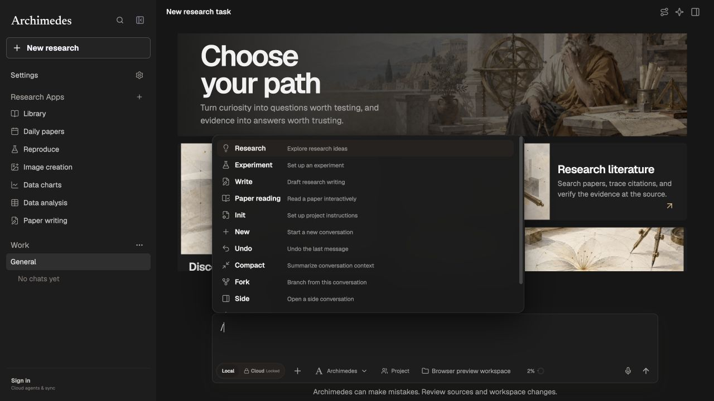
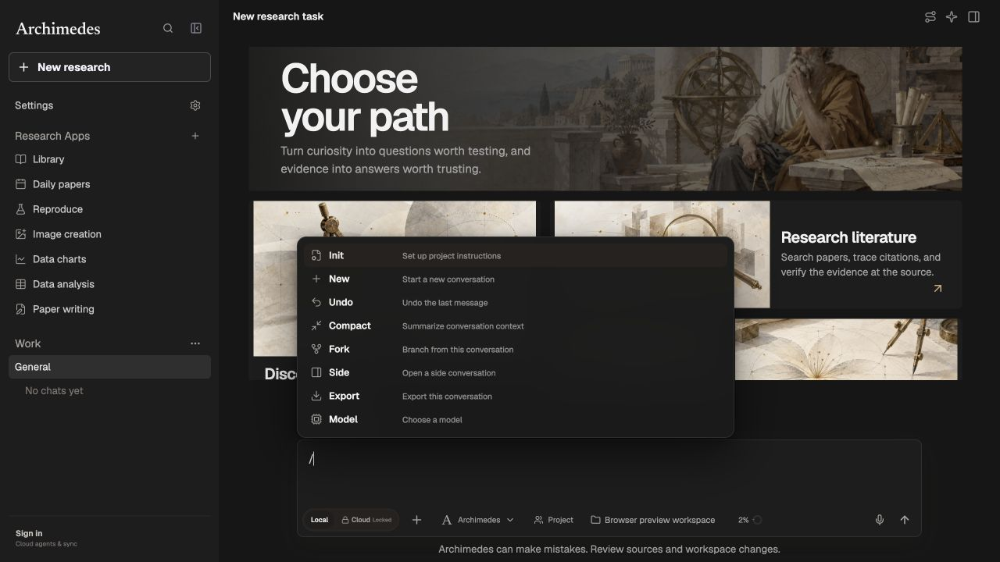

# Slash command cleanup

The composer no longer offers the Research, Experiment, Write or Paper reading slash commands. Its command menu retains Init, New, Undo, Compact, Fork, Side, Export and Model in the existing order. A removed slash word typed alone is treated as ordinary text instead of selecting a research mode; regular research-mode inference remains available for normal prompts.

Validation: the composer and typing-performance tests passed (18 tests); lint, build and theme checks passed. A full run with test concurrency limited to two reported 1083 passed, 4 skipped and 7 previously observed failures: three Benchmark Radar local-checkout cases, the duplicate `Outline` translation, and three Windows shell assertions on macOS.

These screenshots use the same clean preview, viewport and theme before and after the change.

