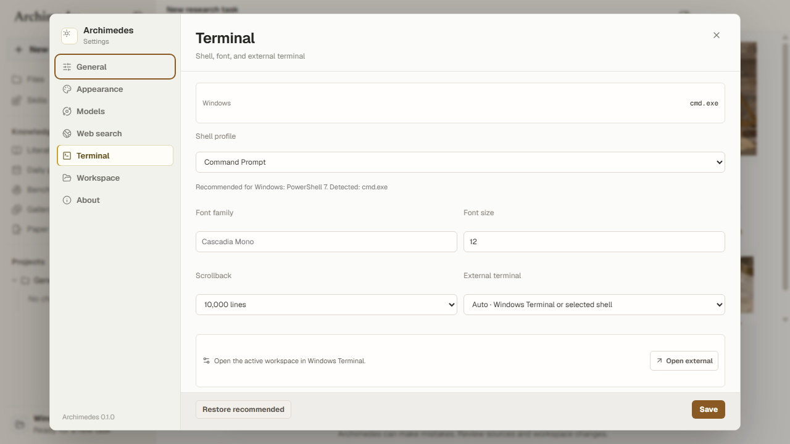

# Windows commands and terminals

Approved commands use the selected shell and include its executable and platform in
the agent context. PowerShell commands preserve Unicode output and native exit
codes. CMD runs in a hidden ConPTY helper so a GUI-launched Electron process can
capture mixed built-in/native UTF-8 output and correctly quote executable paths.
CMD programs see a TTY; use PowerShell for commands that require pipe-based stdout.

Shell discovery accepts case-insensitive environment names and quoted absolute PATH
entries, including portable PowerShell and custom executable names. The external
terminal Auto option falls back to the selected shell when Windows Terminal is absent.
Stopping a command or closing the app terminates its Windows process tree.

Run the command and terminal regression tests:

~~~powershell
node --test electron/command-runner.test.cjs electron/terminal-shell.test.cjs electron/terminal-settings.test.cjs electron/windows-command.test.cjs electron/windows-pty.test.cjs
~~~

## Before and after

Both captures use a 1280x720 content viewport, Paper theme, English, 100% UI
scale, the same disposable workspace, and Settings > Terminal with CMD selected.
The external-terminal Auto label now describes its shell fallback. A separate
real-Electron IPC check executes the identical Chinese CMD command and exit code 7.

### Before

### After

