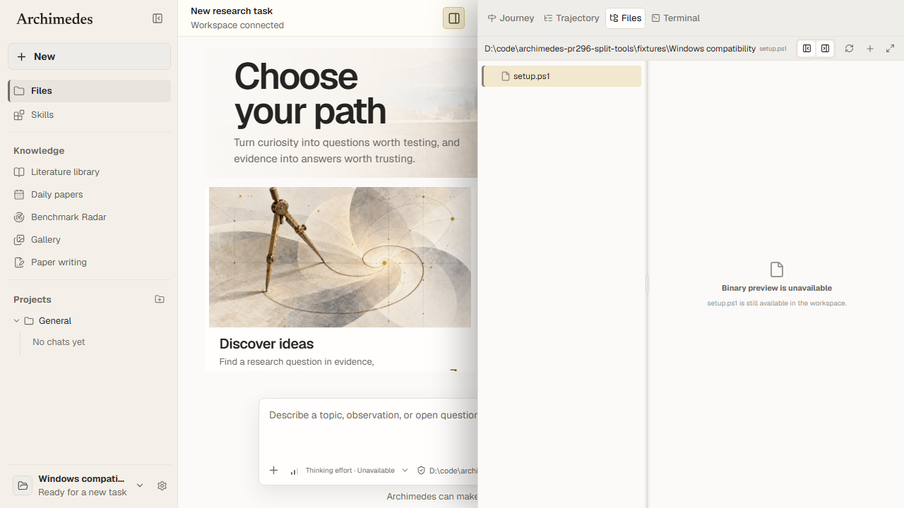
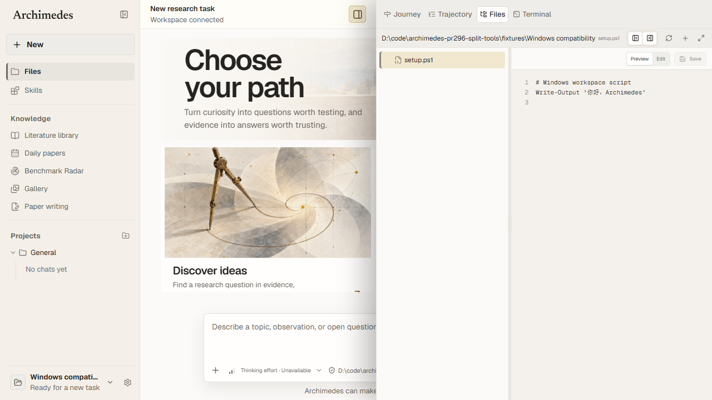

# Windows workspace files and TeX

PowerShell and CMD scripts (.ps1, .psm1, .psd1, .cmd, .bat) are editable text and
contribute line changes to workspace snapshots. Workspace checks accept Windows
case variants and reject paths on other drives, sibling traversal, or directory
junctions resolving outside the workspace. New writes and previews validate the
nearest existing ancestor before creating directories or files.

TeX discovery handles Path casing and quoted absolute entries, ignores directories
named after executables, and uses Windows executable names. Compiler processes stay
hidden and timeouts stop their descendant process tree.

Run the workspace regressions:

~~~powershell
node --test electron/workspace-files.test.cjs electron/latex-workspace.test.cjs electron/skill-catalog.test.cjs electron/windows-workspace.test.cjs
~~~

## Before and after

Both captures use a 1280x720 content viewport, Paper theme, English, 100% UI
scale, the same disposable workspace, and the identical setup.ps1 selected in Files.
Before, it is classified as binary; after, its Chinese text appears in the editor.

### Before

### After

