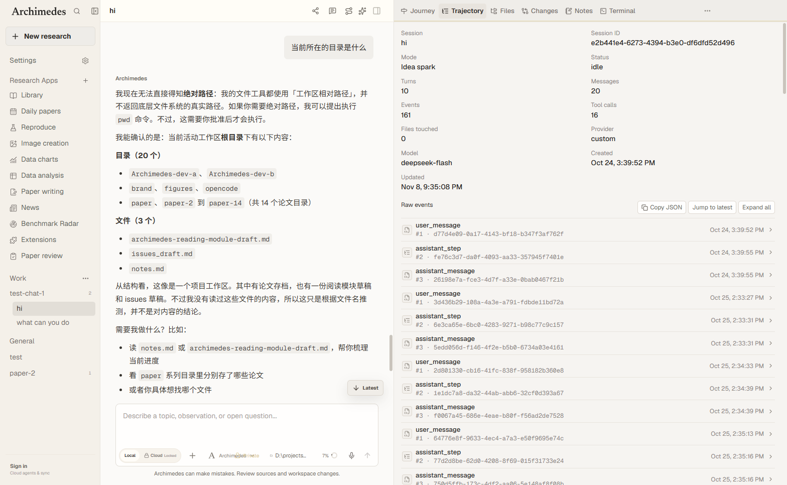
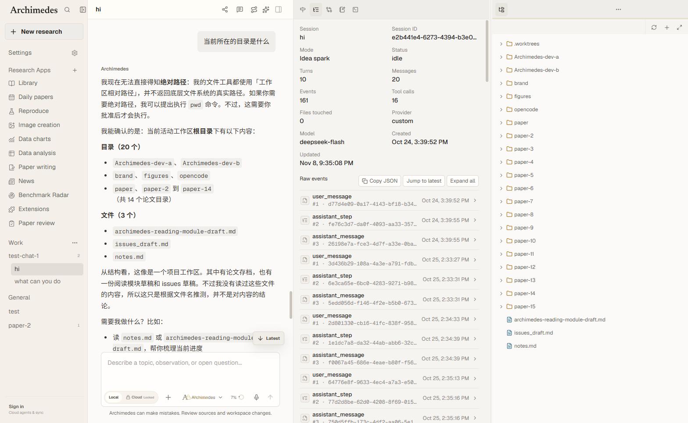
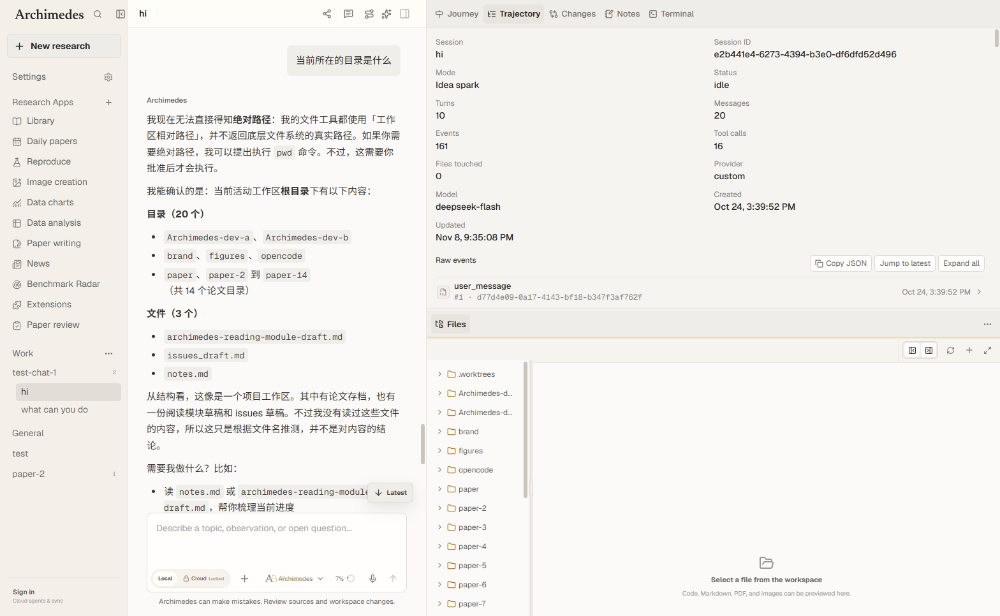
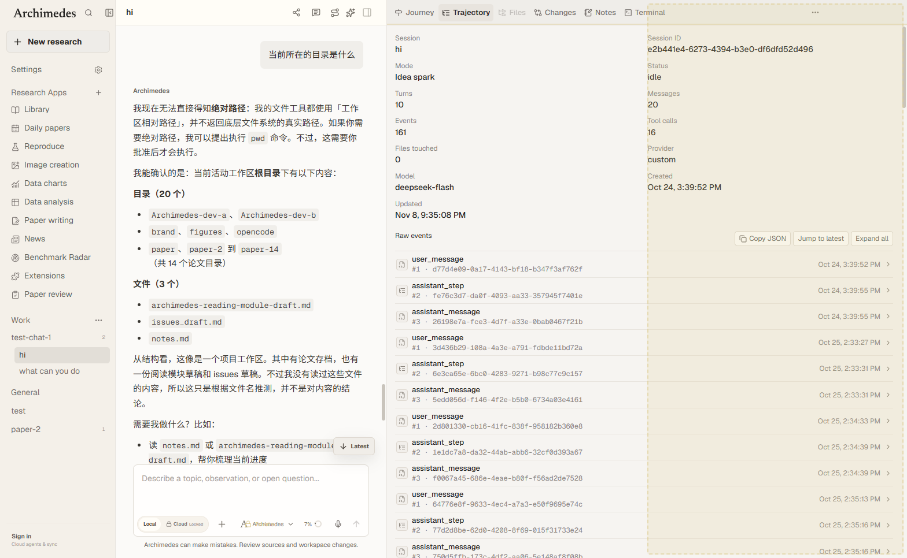

# Workbench split panes

The right workbench can show two panes side by side or stacked. Panes share one
orientation and one set of workbench tabs: a tab belongs to exactly one pane at a
time, so the terminal and browser never mount twice.

| Before: one pane | After: side by side |
| --- | --- |
|  |  |

| Stacked panes | Drop preview |
| --- | --- |
|  |  |

## Using splits

- Drag a tab onto the left or right ~24% of another pane to create a side-by-side
  split, or onto the top/bottom edge to stack panes. A preview shows the drop area.
- Drag a tab onto the middle of another pane to move it there.
- Drag a tab onto another tab to reorder it, or to insert it into that pane.
- Right-click a tab for `Split right`, `Split down`, `Move to other pane`,
  `Close pane`, and `Stacked` / `Side by side` while two panes are open.
- The `…` menu in the focused pane also exposes split and close actions.
- Drag the divider to change the ratio; double-click it (or press `Home`) to reset
  to 50/50. Arrow keys move the divider by 4%.
- `Ctrl/Cmd+1…9` switches tabs in the focused pane.
- `Alt+Shift+←/→` reorders the focused tab inside its pane.

Clicking anywhere in a pane focuses it; the focused pane carries an accent line
under its tab strip and owns the `…` menu and keyboard shortcuts.

## Layout model

`src/workbench-tabs.tsx` owns the pure layout helpers and the preference shape:

```ts
type WorkbenchLayout = {
  orientation: "row" | "column";
  focused: string;
  panes: Array<{
    id: string;
    tabs: WorkbenchTabId[];
    active: WorkbenchTabId;
    size: number; // shares add up to 100
  }>;
};
```

Preferences move to version 4 and gain `layout`. `normalizeWorkbenchPreferences`
and `electron/workbench-settings.cjs` both migrate old data and enforce the same
invariants:

- at most two panes, at least one tab per pane, no duplicated tabs;
- visible tabs missing from a layout are folded into the first pane;
- active tabs always belong to their pane;
- pane shares add up to 100 and keep at least 25% each;
- unknown or duplicate pane ids are repaired.

Layout survives reloads through `workbench-settings.json` in the Electron user
data directory, alongside the existing tab order and visibility.

## Width behavior

`RightWorkbench` widens the workbench to 900px when a side-by-side split is
created, clamped by the existing viewport rules (main content keeps at least
560px). A side-by-side split cannot be resized below 640px. Narrow viewports keep
the existing overlay workbench behavior.

Each pane measures itself with `ResizeObserver`; below 460px it switches to
icon-only tabs and shortens Notes/Journey chrome, so a split never relies on the
whole workbench width.

## Limitations

- Phase 1 supports two panes and one global orientation; nested split trees are
  not implemented.
- Moving a tab between panes remounts its panel. Terminal sessions reattach (the
  PTY lives in the main process), but the embedded browser reloads its page.
- Tabs stay single-instance by design; there is no "duplicate this tab" action.

## Verification

- `electron/workbench-settings.test.cjs` covers layout normalization, migration
  from v3, duplicate/orphaned tabs, pane limits, and size clamps.
- `electron/ui-audit-workbench-split.test.cjs` covers the pane model, drag/drop
  wiring, per-pane mounting, persistence plumbing, CSS, and translations.
- Manual Electron runs verified drag-to-split (row and column), center moves,
  cross-pane tab drops, divider and keyboard resizing, orientation toggles,
  pane close/merge, hidden-tab show/hide, and persistence across restarts.
