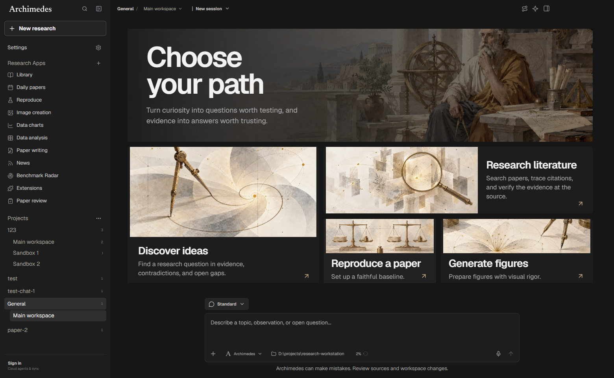
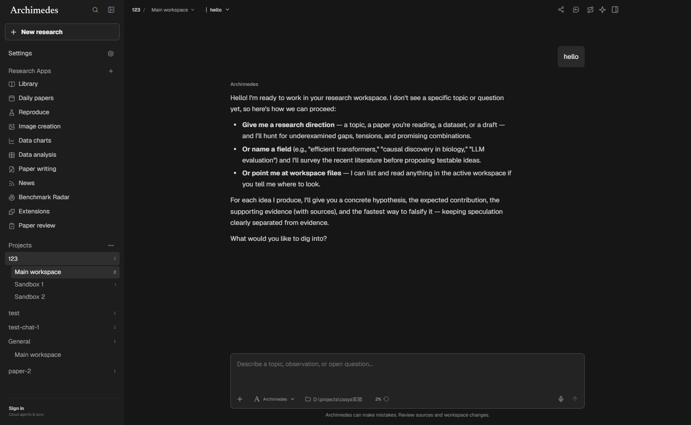
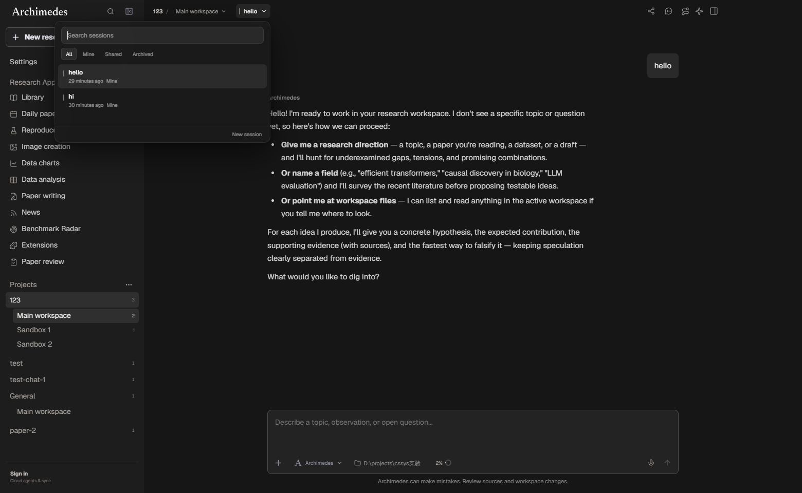
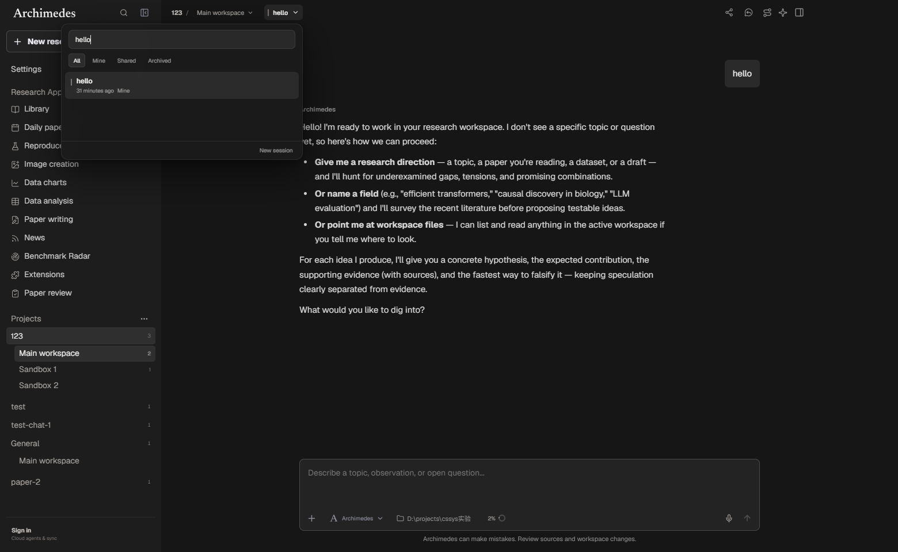
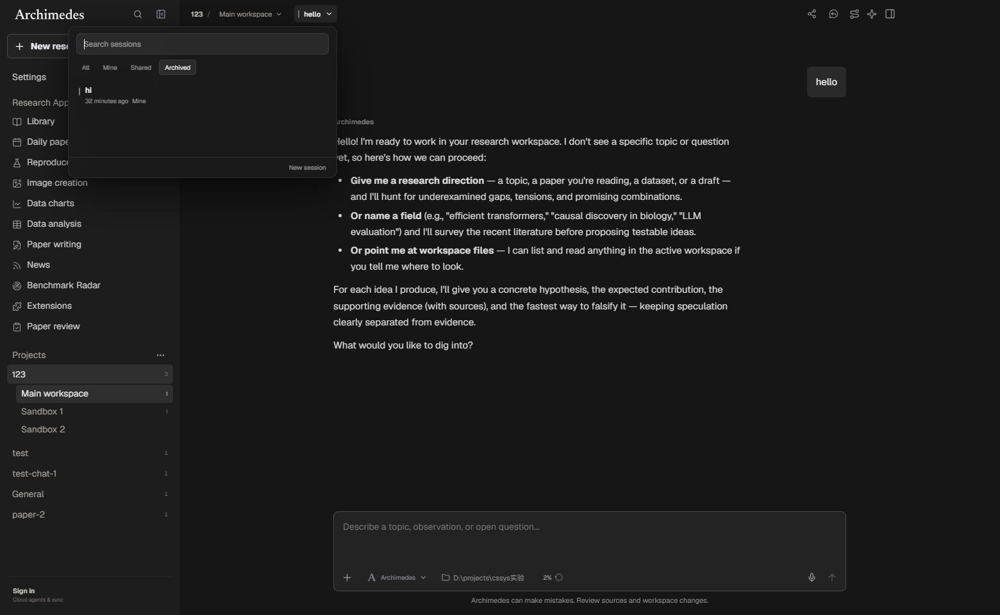
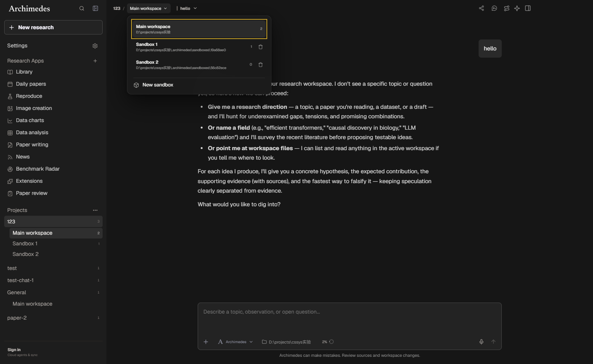
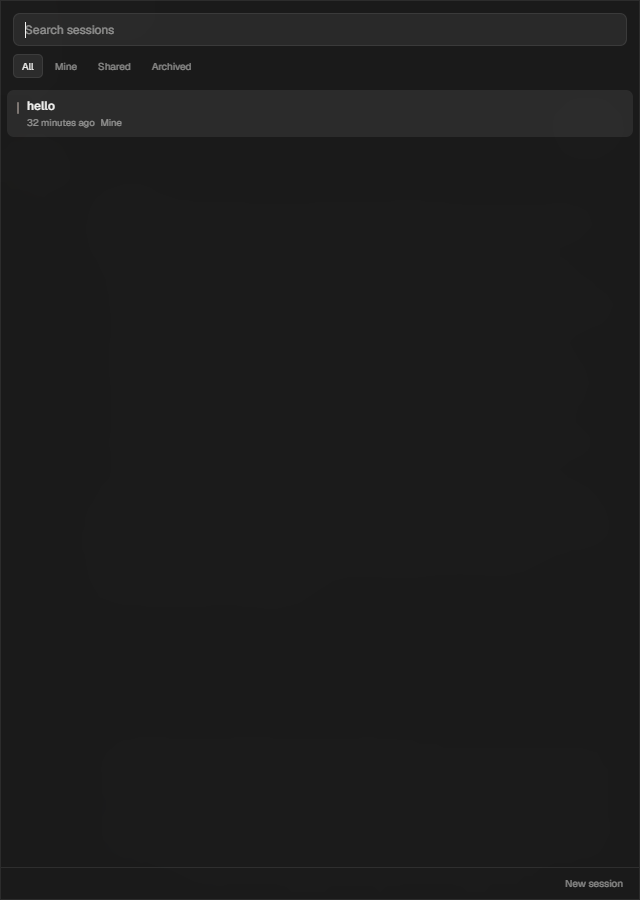
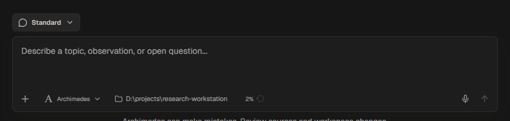

# Project, workspace and session model

This change turns the right-hand Workbench's sibling into a real research
container hierarchy:

```text
Project (topic)
  └── Workspace (bench)
        └── Session (one conversation / run)
              └── Artifact (output)
```

The implementation follows #273 and covers the first vertical slice: the local
data model, Git-aware workspaces, and the toolbar session switcher. The main
conversation no longer uses top tabs; it uses a breadcrumb plus one session chip.

## What changed

### Data model

- New `project_environments` and `project_workspaces` tables.
- `research_projects` gain `environment_id`, `git_state`, and `git_branch`.
- `research_threads` gain `workspace_id`, `parent_id`, `fork_id`, `pinned`,
  `last_viewed_at`, and `unread_count`. Existing `workspace_path` remains the
  session's `cwd` snapshot.
- `research_artifacts` gain `project_id`, `storage`, and `sha256`.
- Opening an existing database migrates every project into one local
  environment and one shared workspace, then attaches historical sessions to
  that workspace. No files are copied and no historical row is rewritten apart
  from the new fields.

`git_state` is one of `none | empty | ready | nested | suspicious`. The probe only
runs for a project root that actually has `.git`; a project without Git keeps the
same model and uses a shared or sandbox workspace.

### Workspaces

Three kinds are supported:

| Kind | Default | Use | Files |
| --- | --- | --- | --- |
| `shared` | yes | reading papers, notes, ordinary chat | project folder, no copy |
| `worktree` | only when `git_state = ready` | code changes on an isolated branch | `git worktree` under `.archimedes/worktrees` |
| `sandbox` | always | non-Git isolation | copy under `.archimedes/sandboxes`, skipping `.git`, `.archimedes`, `node_modules`, `dist`, `build`, `.next` |

Sessions are single-instance and belong to exactly one workspace. Deleting a
non-shared workspace moves its sessions back to the shared workspace; a Git
worktree is removed with `git worktree remove --force`.

The left sidebar now follows the same hierarchy: `Projects`, then the
workspaces under each project. Session titles stay in the session switcher; the
sidebar never lists individual conversations.

#### Workspace and session names

| Item | Name |
| --- | --- |
| shared workspace | `Main workspace` (localized by the UI) |
| worktree | `Worktree 1`, `Worktree 2`, … |
| sandbox | `Sandbox 1`, `Sandbox 2`, … |
| session with a prompt | the first prompt, shortened to 72 characters |
| new empty session | `New session` |
| fork / side conversation | `Fork: …` / `Side: …` |

The project-row `+` creates one workspace directly: a worktree when the project
repository is ready, otherwise a sandbox. The full workspace menu still offers
both choices, but hides Git worktrees for folders without `.git`.

### Session switcher

The main toolbar now shows:

```text
Project / Workspace        ● Session title ▾
```

The chip opens a searchable popover with:

- `All`, `Mine`, `Shared`, and `Archived` filters;
- pinned sessions first, separated from the rest by a divider;
- per-session status: running, needs review, failed, unread, idle;
- pin/unpin and archive/restore actions;
- `Alt+↑/↓` or `Ctrl+Shift+[ / ]` to move between sessions in the current
  workspace;
- `Ctrl/Cmd+Shift+K` to open the switcher. `Ctrl/Cmd+K` remains the command
  palette shortcut;
- a full-height sheet below 720px instead of a floating popover.

The selected session uses a quiet background highlight with no extra accent
bar, and the footer keeps only a text `New session` action.

Session switching keeps per-session composer drafts and conversation scroll
positions. It does not stop a running turn.

### Composer

The composer footer now keeps the context picker, harness picker, workspace
folder shortcut, and context usage. The duplicate `Local` / `Cloud` runtime
switch and the `Project` / `Private` visibility toggle were removed; new
conversations remain project-visible by default.

## Screenshots

| Projects → workspaces | Main toolbar |
| --- | --- |
|  |  |

| Session switcher | Search |
| --- | --- |
|  |  |

| Archived | Workspace menu |
| --- | --- |
|  |  |

| Narrow sheet | Composer footer |
| --- | --- |
|  |  |

## Decisions on the open questions in #273

1. **One local database or global catalog + per-project databases?**
   This slice keeps one SQLite database per workspace and scopes rows by
   `project_id`. It is the least disruptive migration and keeps every existing
   project, library and annotation readable. The `environment_id` and
   `workspace_id` indirection leaves room for the catalog/project split later.
2. **Can a session write the shared workspace?**
   Yes. Sessions remain read/write by default and write actions still use the
   existing approval surface. A file lease and visible conflict resolution UI
   are not part of this slice.
3. **Which session shortcut?**
   `Alt+↑/↓` and `Ctrl+Shift+[ / ]` both cycle sessions. `Ctrl/Cmd+K` stays the
   command palette shortcut; `Ctrl/Cmd+Shift+K` opens the session switcher.
4. **Where do artifacts live?**
   Artifacts stay local by default. `storage` exists so a later publish step can
   mark an artifact `remote` without moving the file.
5. **What happens to the old Supabase collaboration path?**
   It is untouched in this slice. Collaboration remains governed by #261 and is
   not moved to the relay here.

## Deliberately not in this slice

- Nested workspaces, more than one shared workspace per project, or copies per
  session.
- File lease enforcement, three-way merge, and the conflict UI from P1.
- Artifact export and cache cleanup from P3.
- Yjs relay and server-side collaboration from P4/P5.

## Verification

- `electron/git-state.test.cjs` covers `none`, `empty`, `ready`, `nested`, and
  `suspicious`.
- `electron/workspace-session-model.test.cjs` covers migration, workspace
  filtering, pin/viewed state, sandbox copies, worktree creation/removal, and
  the no-Git rejection path.
- `electron/ui-audit-workspace-session.test.cjs` covers the toolbar, popover,
  filters, shortcuts, bridge wiring, responsive sheet, and translations.
- Existing workbench, i18n, titlebar and project-workspace tests were updated
  where they asserted the old single-tab toolbar or thread signature.

Manual Electron checks: open an existing database, switch projects and
workspaces, create/delete a sandbox and worktree, search/pin/archive sessions,
switch with the keyboard, verify draft and scroll restoration, and resize below
720px for the sheet.
